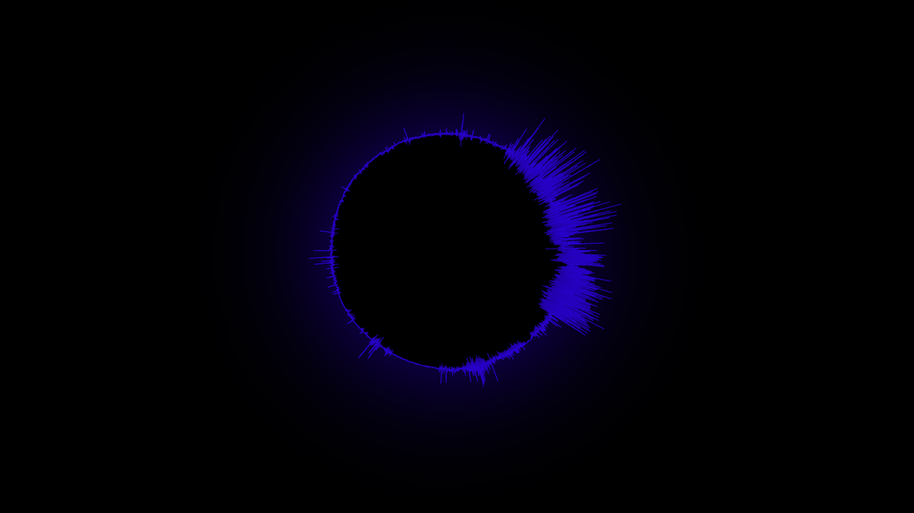
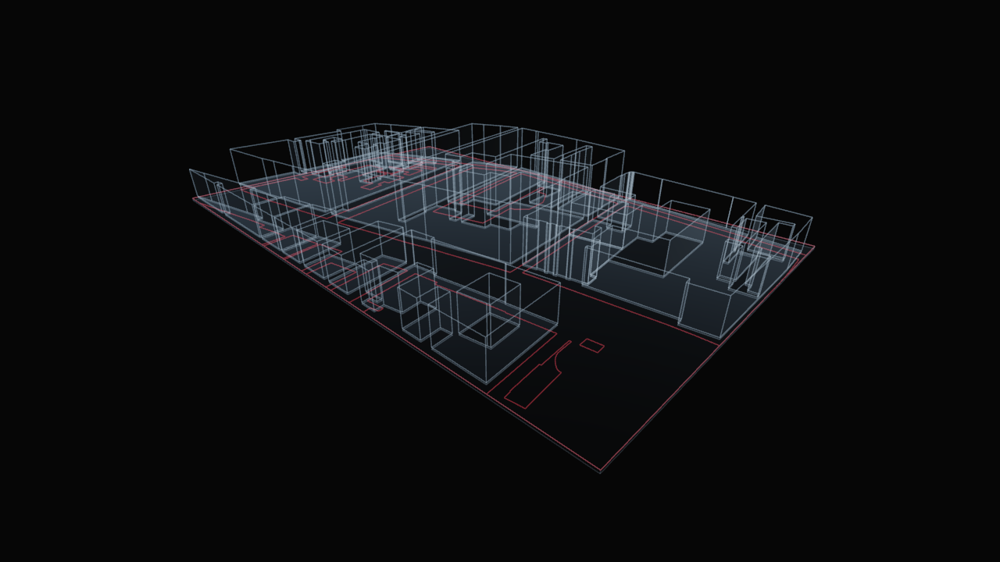
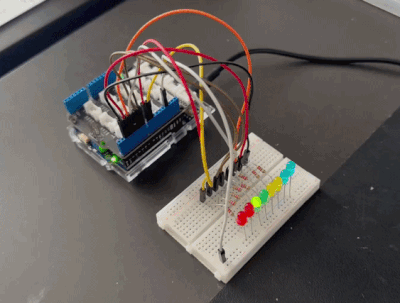

# vvvv — Visual Catalogue

[RC15 Resources](../README.md) · [vvvv learning pathway](vvvv.md)

A visual index of the **vvvv gamma** patches, example projects and related workflows in RC15 Resources. Choose an example by what you want to make or investigate; the explanations and comments remain in the original patches.

**This catalogue is being illustrated.** Some previews below reuse existing project images. Other entries have a clearly named screenshot slot ready to be filled. The descriptions summarise the existing resource READMEs and patch filenames; they are not claims that every patch has been run in a current vvvv installation.

## Filling in the images

1. Open a patch in vvvv and capture its **result** whenever possible. A patch screenshot can be a second image if it explains the method better.
2. Save a clear landscape screenshot (ideally around **1200 × 750 px**, PNG or JPG) under `software/images/vvvv/`, using the filename shown in the image slot. Create the folders if they do not yet exist.
3. In this document replace `📷 Add screenshot...` in the relevant table cell with ``.
4. Where a resource contains several patches, the detailed patch lists below include optional filenames for additional images. Only add screenshots that reveal a useful difference; not every patch needs its own preview.
5. If an example requires a specific version, package, asset folder or a local path correction, record that in its existing README. Do not mistake a saved screenshot for proof of current compatibility.

A single strong preview per resource is enough to make the catalogue useful. **Keep the images of genuine patch outputs** rather than generic illustrations.

## Browse by subject

[Getting started and visual output](#getting-started-and-visual-output) · [Geometry and spatial data](#geometry-and-spatial-data) · [Simulation and movement](#simulation-and-movement) · [Sound, sensing and physical interaction](#sound-sensing-and-physical-interaction)

## Getting started and visual output

| Preview | Resource | What it contains |
| --- | --- | --- |
| 📷 **Add screenshot** <code>graphics-fundamentals.png</code> | **[vvvv Graphics Fundamentals](../tutorials/visualisation-and-rendering/vvvv-graphics-fundamentals/README.md)** | Eight examples: node connections, Skia and Stride exports, imported meshes, materials and fog. |
|  | **[Circular Graphs and 2D Export](../tutorials/visualisation-and-rendering/circular-graphs/README.md)** | Build circular data graphics in Skia and investigate PDF or image export. |
|  | **[vvvv Extended Examples](../tutorials/visualisation-and-rendering/vvvv-extended-examples/README.md)** | Twenty patches covering graphics, sensors, cameras, SDFs, particles and Rhino geometry. |
| 📷 **Add screenshot** <code>combining-2d-and-3d.png</code> | **[Combining 2D and 3D](../tutorials/visualisation-and-rendering/combining-2d-and-3d/README.md)** | Bring Skia-style 2D graphics and Stride 3D content into one composition. |
| 📷 **Add screenshot** <code>drawing-fog.png</code> | **[Drawing Fog](../tutorials/visualisation-and-rendering/fog/README.md)** | Four patches exploring atmospheric effects through texture processing. |

## Geometry and spatial data

| Preview | Resource | What it contains |
| --- | --- | --- |
| 📷 **Add screenshot** <code>signed-distance-fields.png</code> | **[Signed Distance Fields](../tutorials/geometry-and-modelling/signed-distance-fields/README.md)** | Five examples of implicit shapes, transformations, noisy spheres and outlines using VL.Fuse. |
| 📷 **Add screenshot** <code>reading-point-clouds.png</code> | **[Reading Point Clouds](../tutorials/geometry-and-modelling/reading-point-clouds/README.md)** | Import PLY scan data and display a point cloud in a 3D scene. |
|  | **[Rhino and Grasshopper Import](../tutorials/geometry-and-modelling/rhino-grasshopper-import/README.md)** | Exchange geometry with Rhino/Grasshopper and explore exporting animation frames. |

## Simulation and movement

| Preview | Resource | What it contains |
| --- | --- | --- |
| 📷 **Add screenshot** <code>baking-sdfs-with-particles.png</code> | **[Baking SDFs with Particles](../tutorials/simulation-and-agents/baking-sdfs-with-particles/README.md)** | Capture procedural particle positions and develop the resulting geometry in Rhino. |
| 📷 **Add screenshot** <code>rhino-vvvv-series.png</code> | **[Rhino and vvvv — Geometry, Particles and Moving People](../tutorials/simulation-and-agents/rhino-vvvv-series/README.md)** | Four projects linking site geometry and Grasshopper to particles and animated people. |
| 📷 **Add screenshot** <code>vl-fuse-simulation.png</code> | **[VL.Fuse — SDFs and Fluid Simulation](../tutorials/simulation-and-agents/fuse-simulation-series/README.md)** | Explore mathematical fields as forms and boundaries for fluid-like simulations. |

## Sound, sensing and physical interaction

| Preview | Resource | What it contains |
| --- | --- | --- |
| 📷 **Add screenshot** <code>sound-analysis.png</code> | **[Sound Analysis](../tutorials/data-analysis-and-machine-learning/sound-analysis/README.md)** | Investigate waveforms, frequency analysis and audio-reactive behaviour. |
| 📷 **Add screenshot** <code>gsr-to-umap.png</code> | **[GSR to UMAP](../tutorials/data-analysis-and-machine-learning/gsr-to-umap/README.md)** | Transform a recorded GSR signal through Python into UMAP coordinates; includes a vvvv visualisation example. |
| 📷 **Add screenshot** <code>arduino-sensor-input.png</code> | **[Arduino Sensor Input into vvvv](../tutorials/physical-computing-and-interaction/arduino-sensor-input/README.md)** | Read a light sensor over serial and graph or record the values in vvvv. |
|  | **[LED Control with vvvv and Arduino](../tutorials/physical-computing-and-interaction/led-control/Readme.md)** | Send serial commands to control eight LEDs, building different on/off patterns. |

## Inside the larger collections

The two collections below contain numerous separate patches. These tables are a checklist for optional *individual* screenshots and short descriptions. The main catalogue above can remain compact even when these are populated.

### vvvv Graphics Fundamentals — eight patches

**Main collection:** [Graphics Fundamentals](../tutorials/visualisation-and-rendering/vvvv-graphics-fundamentals/README.md). For any individual preview, use the indicated filename in `software/images/vvvv/` and replace that cell with an image tag.

| Image to add | Patch | Purpose |
| --- | --- | --- |
| `01-bare-bones.png` | [01 Bare Bones](../tutorials/visualisation-and-rendering/vvvv-graphics-fundamentals/01%20Bare%20Bones.vl) | A minimal patch for understanding nodes and connections. |
| `02-stride-export-image.png` | [02 Stride Export Image](../tutorials/visualisation-and-rendering/vvvv-graphics-fundamentals/02%20Stride%20Export%20Image.vl) | Export a 3D-rendered image. |
| `03-skia-export-image.png` | [03 Skia Export Image](../tutorials/visualisation-and-rendering/vvvv-graphics-fundamentals/03%20Skia%20Export%20Image.vl) | Export a 2D graphic. |
| `04-stride-images-in-3d-space.png` | [04 Stride Images in 3D Space](../tutorials/visualisation-and-rendering/vvvv-graphics-fundamentals/04%20Stride%20Images%20in%203D%20Space.vl) | Place images within a 3D scene. |
| `05-stride-animate-materials.png` | [05 Stride Animate Materials](../tutorials/visualisation-and-rendering/vvvv-graphics-fundamentals/05%20Stride%20Animate%20Materials.vl) | Animate material properties. |
| `06-import-obj-mesh.png` | [06 Import OBJ Mesh](../tutorials/visualisation-and-rendering/vvvv-graphics-fundamentals/06%20Import%20OBJ%20Mesh.vl) | Read external OBJ mesh geometry. |
| `07-render-styles-textures.png` | [07 Render Styles Textures](../tutorials/visualisation-and-rendering/vvvv-graphics-fundamentals/07%20Render%20Styles%20Textures.vl) | Compare materials and textures. |
| `08-fog.png` | [08 Fog](../tutorials/visualisation-and-rendering/vvvv-graphics-fundamentals/08%20Fog.vl) | Investigate an atmospheric effect. |

### vvvv Extended Examples — twenty patches

**Main collection:** [Extended Examples](../tutorials/visualisation-and-rendering/vvvv-extended-examples/README.md). This is an archive of individual experiments, not a single continuous sequence.

| Image to add | Patch | Purpose |
| --- | --- | --- |
| `01-arduino-read-temp-and-humidity.png` | [01 Arduino Read Temp and Humidity](../tutorials/visualisation-and-rendering/vvvv-extended-examples/01%20Arduino%20Read%20Temp%20and%20Humidity.vl) | Receive environmental sensor readings. |
| `02-simple-graph-and-2d-export.png` | [02 Simple Graph and 2D Export](../tutorials/visualisation-and-rendering/vvvv-extended-examples/02%20Simple%20Graph%20and%202D%20Export.vl) | Graph data and export an image. |
| `03-circle-graph.png` | [03 Circle Graph](../tutorials/visualisation-and-rendering/vvvv-extended-examples/03%20Circle%20Graph.vl) | Build a circular data graphic. |
| `04-overlay-stride-and-skia.png` | [04 Overlay Stride and Skia](../tutorials/visualisation-and-rendering/vvvv-extended-examples/04%20Overlay%20Stride%20and%20Skia.vl) | Combine two rendering systems. |
| `05-simple-camera-animation.png` | [05 Simple Camera Animation](../tutorials/visualisation-and-rendering/vvvv-extended-examples/05%20Simple%20Camera%20Animation.vl) | Animate a viewpoint. |
| `06-sdfs.png` | [06 SDFs](../tutorials/visualisation-and-rendering/vvvv-extended-examples/06%20SDFs.vl) | Explore implicit geometry. |
| `07-import-obj.png` | [07 Import OBJ](../tutorials/visualisation-and-rendering/vvvv-extended-examples/07%20Import%20OBJ.vl) | Read mesh geometry. |
| `08-sdf-02.png` | [08 SDF 02](../tutorials/visualisation-and-rendering/vvvv-extended-examples/08%20SDF%2002.vl) | Extend the SDF examples. |
| `09-particle-compute-system.png` | [09 Particle Compute System](../tutorials/visualisation-and-rendering/vvvv-extended-examples/09%20Particle%20Compute%20System.vl) | Investigate particle computation. |
| `10-particle-blend-methods.png` | [10 Particle Blend Methods](../tutorials/visualisation-and-rendering/vvvv-extended-examples/10%20Particle%20Blend%20Methods.vl) | Compare visual blending. |
| `11-particle-simple-system.png` | [11 Particle Simple System](../tutorials/visualisation-and-rendering/vvvv-extended-examples/11%20Particle%20Simple%20System.vl) | Start a particle system. |
| `12-particle-amount-emitter.png` | [12 Particle Amount Emitter](../tutorials/visualisation-and-rendering/vvvv-extended-examples/12%20Particle%20Amount%20Emitter.vl) | Control particle emission. |
| `13-particle-two-emitter-system.png` | [13 Particle Two Emitter System](../tutorials/visualisation-and-rendering/vvvv-extended-examples/13%20Particle%20Two%20Emitter%20System.vl) | Use two particle emitters. |
| `14-particle-many-emitter.png` | [14 Particle Many Emitter](../tutorials/visualisation-and-rendering/vvvv-extended-examples/14%20Particle%20Many%20Emitter.vl) | Use multiple emitters. |
| `15-particle-many-emitter-and-custom-attribute.png` | [15 Particle Many Emitter and Custom Attribute](../tutorials/visualisation-and-rendering/vvvv-extended-examples/15%20Particle%20Many%20Emitter%20and%20Custom%20Attribute.vl) | Add a custom particle attribute. |
| `16-particle-system-simulation.png` | [16 Particle System Simulation](../tutorials/visualisation-and-rendering/vvvv-extended-examples/16%20Particle%20System%20Simulation.vl) | Explore simulated particle behaviour. |
| `17-sdf.png` | [17 SDF](../tutorials/visualisation-and-rendering/vvvv-extended-examples/17%20SDF.vl) | Another implicit geometry experiment. |
| `18-images-in-3d.png` | [18 Images in 3D](../tutorials/visualisation-and-rendering/vvvv-extended-examples/18%20Images%20in%203D.vl) | Place images in a 3D scene. |
| `19-materials.png` | [19 Materials](../tutorials/visualisation-and-rendering/vvvv-extended-examples/19%20Materials.vl) | Investigate material properties. |
| `20-open-rhino-file.png` | [20 Open Rhino File](../tutorials/visualisation-and-rendering/vvvv-extended-examples/20%20Open%20Rhino%20File.vl) | Read Rhino model geometry. |

## Notes for future review

- **Visual completion:** Populate screenshots incrementally; no empty image links are used.
- **Technical verification:** Check patch versions, external packages and file paths in the relevant tutorial README rather than asserting compatibility here.
- **Editorial scope:** This page describes and helps locate examples; node-by-node explanations belong inside the annotated patches.

[Return to the vvvv learning pathway](vvvv.md) · [RC15 Resources](../README.md)
