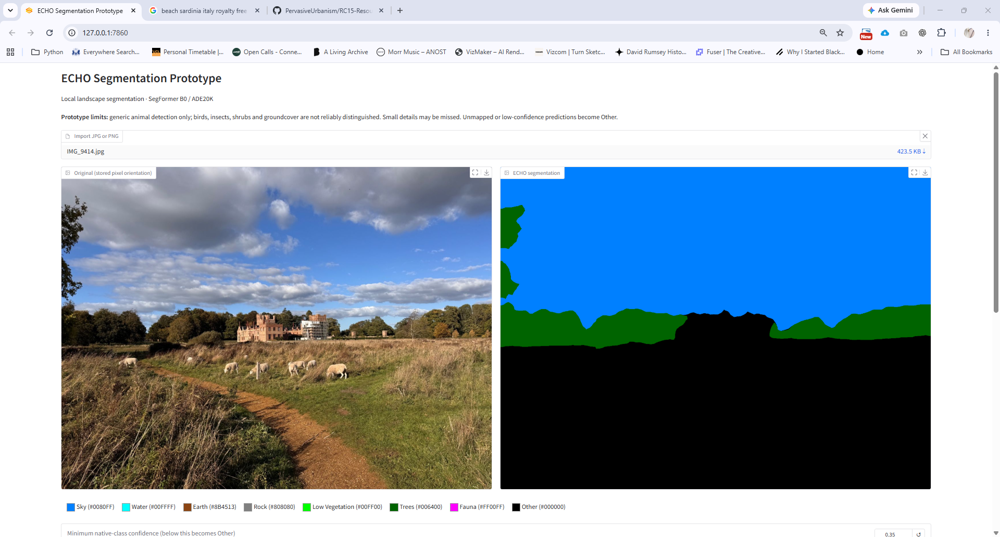
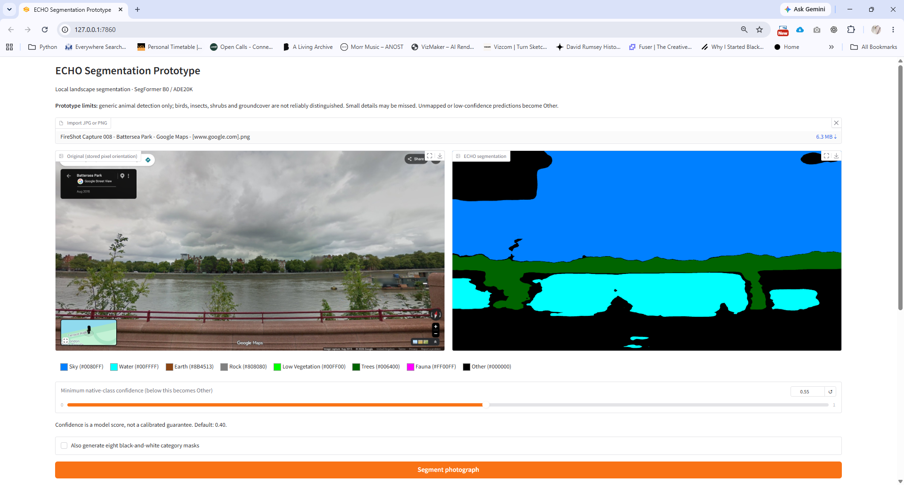
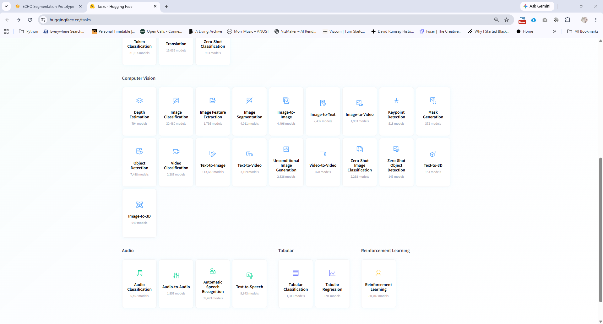

# Image Segmentation with AI: Build Your Own Tool with Codex

*Turn a photograph into a map of its contents, then explore what else pretrained AI models can reveal.*

[RC15 Resources](../../../README.md) · [AI and research methods](../README.md)

**Level:** Beginner, with basic familiarity with files and folders  
**Software:** [Codex](https://openai.com/codex/), Python and a web browser  
**Time:** Approximately 30–60 minutes for a first experiment; installing packages and downloading a model may take longer  
**You will learn:** How to brief an AI coding agent, use a pretrained model, test an application and assess the reliability of its output.

Imagine photographing a public square and asking a computer to distinguish the sky, trees, buildings and ground. Rather than describing the whole photograph with a sentence, we want a new image in which each pixel is assigned to a category. This is **semantic image segmentation**.

The aim here is not to copy a finished application or train an AI model. You will use **Codex**, an AI coding agent, to help you build a small Python tool of your own. You decide what the tool should do, test it with photographs and refine the results.

## 1. What does image segmentation do?

A photograph contains millions of pixels, but their colours do not tell us directly what they represent. A segmentation model has learnt statistical patterns from labelled training images. Given a new photograph, it predicts a category for each pixel: perhaps *sky*, *tree*, *building* or *road*.

The result is a **classification map**. Each colour can stand for a category, rather than the colour seen in the original photograph. A bright green tree in this map means “the model classified these pixels as trees”, not “these pixels were green in the photograph”.

Different models recognise different things. A model trained on everyday scenes might distinguish buildings and vegetation, but not identify individual tree species or separate every pavement from every road. **Semantic segmentation** groups pixels by class; it does not necessarily separate two people or two trees into individual objects. That would require *instance segmentation* or another suitable technique.

Pretrained models are available on [Hugging Face](https://huggingface.co/models?pipeline_tag=image-segmentation). One example is [SegFormer B0 trained on ADE20K](https://huggingface.co/nvidia/segformer-b0-finetuned-ade-512-512), which predicts categories from a larger set of scene labels. We can adapt its predictions into a smaller, more useful palette, but we cannot assume it recognises categories it was never trained to distinguish.

## 2. Describe the tool to Codex

Open Codex in the coding environment you normally use and create a **new, empty project folder**. Codex may suggest different Python libraries or models; that is fine, provided you can explain the choice. Ask it to create a local interface so you can try the model without writing commands for every image.

Here is a starting prompt:

> Build a beginner-friendly Python application for semantic image segmentation. I want to upload a JPG or PNG photograph of a public space, run a pretrained model and see the original image beside a colour-coded segmentation. Use a simple local web interface, for example Gradio. Do not train a model or use a paid API. Explain which pretrained model you chose, what categories it recognises, how to install the required packages and how to run the application on Windows. Keep the project small and readable, and save the output as a PNG.

Read Codex's plan before accepting it. You should be able to answer three questions: *Where does the model come from? Does processing happen on my computer or through an online service? What files will the application create?*

A model hosted on Hugging Face may download to your computer on its first run. The model card also tells you about intended uses, limitations and licence conditions. **Being downloadable does not automatically mean unrestricted use.**

## 3. Run your first segmentation

Ask Codex to show you how to run the application. It may set up a **virtual environment**, an isolated Python installation for this project, and install packages such as PyTorch, Transformers, Pillow and Gradio. Follow the instructions it generated for your computer rather than copying commands blindly. If an installation fails, show Codex the complete error message and ask what it means.

When the local interface opens in your browser, upload a photograph that you have permission to use. A landscape, park or street with clearly distinguishable elements is a useful starting point. Run the segmentation and compare the two images side by side.

Look closely at the boundaries. Are trees distinct from the sky? What happens to a person partly hidden by a bicycle? Does the model recognise a narrow path? The display may look convincing from a distance, but small details are often where problems become visible.

## 4. Refine the application through testing

Now give Codex a more precise brief. For an urban photograph, you might choose just six categories: **sky, vegetation, buildings, ground, people and other**. Ask for one clearly distinct, exact RGB colour per category, a legend and a downloadable PNG at the original image dimensions.

> Please simplify the segmentation to six categories: sky, vegetation, buildings, ground, people and other. Show me how the pretrained model's original labels map to these categories before you change the application. Any label that does not clearly fit should become “other”. Use fixed RGB colours, preserve the input image's pixel dimensions, and export a PNG without blending colours at category boundaries. Add a legend.

This mapping is a design decision, not something the model automatically knows. For example, should *road*, *pavement* and *earth* all count as ground? Should a potted plant count as vegetation? Check the actual labels recognised by your model and avoid making classifications more precise than its training allows.

For the next iteration, ask Codex to export **binary masks**: one black-and-white image per category, with white pixels marking the selected class and black pixels marking everything else. These are useful for recolouring or isolating portions of an image in Illustrator, Photoshop, Rhino or other creative software.

> Add an option to download a black-and-white mask for each category, as individual PNGs or one ZIP. Use white for pixels in that category and black for all other pixels. Explain how I can check that the masks align exactly with the original image.

Try three images with different conditions: a clear daytime landscape, a crowded street and an image with shadows or unusual lighting. Compare the results rather than treating the first successful run as proof that the tool works. Ask Codex how to verify image dimensions and exact mask values, but **inspect the output yourself**. A working interface is not the same as a reliable classification.

If the tool is slow, ask whether it is running on the CPU rather than a GPU. If a model fails to load, check its requirements and download status. If the colours look inconsistent, confirm whether Codex is exporting class IDs through a fixed palette or resizing the final colour image with smoothing. Fix one problem at a time and retest with the same photograph.

**A small challenge:** Can you use one of the masks to recolour just the vegetation in a drawing or photographic collage? The output is already a bridge between AI analysis and a creative workflow.

## 5. Beyond segmentation: what else can we analyse?

Image segmentation is one example of a wider approach: find a suitable **pretrained model**, understand its input and output, then use Codex to build a small application around it. [Hugging Face Tasks](https://huggingface.co/tasks) provides a useful starting point for discovering these possibilities.

| Technique | What it produces | An architectural or urban-design question |
| --- | --- | --- |
| [Pose estimation](https://huggingface.co/models?search=pose%20estimation) | Locations of body joints, often drawn as a skeleton | How do gestures and postures vary between activities in a public space? |
| [Depth estimation](https://huggingface.co/models?pipeline_tag=depth-estimation) | An estimated depth value for image regions | Can a photograph become a layered spatial composition? |
| [Object detection](https://huggingface.co/models?pipeline_tag=object-detection) | Bounding boxes and object classes; tracking needs additional methods | Which types of objects occupy a street scene? |
| [Audio classification](https://huggingface.co/models?pipeline_tag=audio-classification) | Predicted sound categories from recordings | Where do traffic, speech or birdsong dominate a soundscape? |
| [Speech recognition](https://huggingface.co/models?pipeline_tag=automatic-speech-recognition) | A text transcription of recorded speech | How can interviews be searched and compared? |
| [Text classification and sentiment analysis](https://huggingface.co/models?pipeline_tag=text-classification) | Labels or scores assigned to text | How do written descriptions of a place differ across sources? |

These are **different analysis tasks**, not additional features of the same segmentation algorithm. A pose model can estimate body joints, but a 2D skeleton is not automatically an accurate 3D reconstruction. A depth map is not a measured survey. Likewise, sentiment labels depend on the model, language and context; they are not direct measurements of how someone feels. For recording people or analysing their speech, consider consent, privacy and data protection before collecting material.

### Try another model

Choose one technique from the table. Find a model on Hugging Face, read its model card and ask Codex to create the smallest possible application that lets you supply your own input and inspect the result. Start with one image, recording or short passage. Ask what the model was trained to recognise, what hardware it needs and how you could test the output against something you can verify.

You do not need to understand every line of generated Python on day one. You do need to understand **what goes in, what the model claims to produce, where it can fail and what you can reasonably conclude from the result**. That is how AI-assisted coding becomes a method of investigation rather than merely a way of generating software.

## Further reading

- [Codex](https://openai.com/codex/) — AI-assisted coding environment
- [Hugging Face Tasks](https://huggingface.co/tasks) — overview of machine-learning tasks
- [Hugging Face image segmentation models](https://huggingface.co/models?pipeline_tag=image-segmentation) — examples and model cards
- [SegFormer B0 / ADE20K model card](https://huggingface.co/nvidia/segformer-b0-finetuned-ade-512-512) — an example of a pretrained scene segmentation model
- [Gradio](https://www.gradio.app/) — Python interfaces for machine-learning applications

---

<!-- Editorial checklist: Check image rights and illustration accuracy; verify software steps in a fresh environment. No application source is distributed with this tutorial. -->
