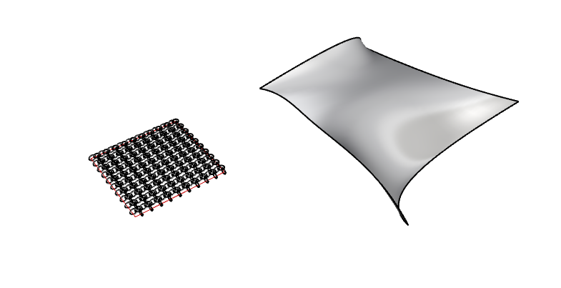
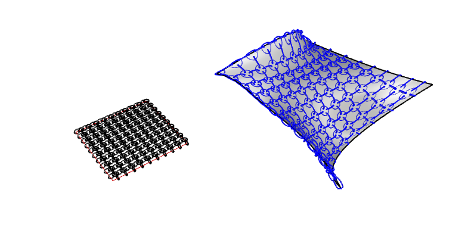
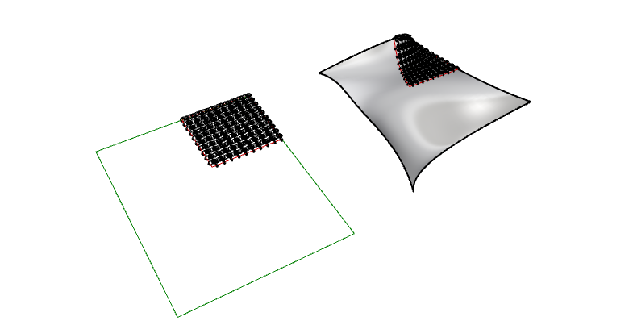

# Flow Along Surface in Rhino

Part of **RC15 Resources**, the permanent tutorial library for Pervasive Urbanism.

**Software:** Rhino  
**Format:** Written tutorial  
**Software versions:** Rhino 8 documentation used for this review; original example version and live application testing unconfirmed.  
**Original collection:** Extra 11 - Rhino Flow along surface

[Browse this topic](../README.md) | [Library home](../../../README.md)

---

# Flow Along Surface in Rhino
### A Practical Guide to Morphing Geometry onto 3D Surfaces


## Introduction — Modelling Complex Geometry with Flow

Some geometries are considerably easier to construct along a straight line or on a flat surface than directly in their final, curved configuration. Rhino provides a powerful family of transformation commands that allow us to take advantage of this.

The simpler command is **Flow**, also known as *Flow Along Curve*. It takes geometry arranged along a reference curve and transforms it along another curve. This is particularly useful when developing curved staircases, repeating façade elements and architectural details. Instead of constructing every element individually around a bend, we can develop the geometry in a straightforward arrangement and then transform it. See the [official Flow documentation](https://docs.mcneel.com/rhino/8/help/en-us/commands/flow.htm).

Its more sophisticated counterpart, **FlowAlongSrf**, extends the principle from curves to surfaces. Geometry developed on a flat reference surface can be transferred onto a curved three-dimensional surface. This opens up possibilities for façade patterns, textile-like structures, ornamentation and other geometries that are difficult to construct directly.

Both commands let us separate **the construction of geometry from its final spatial configuration**. We can work in a simpler setting, then use Rhino to transform the result. Unlike workflows that require conversion to a mesh, these commands can deform NURBS geometry directly, retaining smooth curves and surfaces. The mapping can be very precise, although dimensional changes depend on the source and target geometry, parameterisation and command options.

Grasshopper can also create and manipulate precise NURBS geometry; it is not inherently less smooth. Its advantage is parametric control, while the native Flow commands offer a remarkably direct way to perform a sophisticated transformation without building and maintaining a definition. For many everyday architectural modelling problems, that immediacy can save substantial work.

This tutorial focuses on **FlowAlongSrf**, using a repeating pattern to investigate how flat geometry can be transferred onto a freeform surface, how to control that mapping and how to recognise unwanted distortion.

## The Core Idea

Think of designing a pattern on a flat sheet before wrapping it around a curved form. The source surface provides the coordinate reference and the target surface defines the final shape. Rhino maps points and geometry between the two using their surface parameterisation. The result follows the target, but it **does not necessarily preserve distances, areas or proportions**, particularly on surfaces with uneven parameterisation.

## Step 1 — Setting Up the Source Geometry

Start by drawing your source geometry on a flat plane in a straightforward, rectilinear arrangement. In this example, the source geometry is an interlocking array of circles, arranged as a simple repeating textile-like pattern.

> **Tip:** Begin with a simple, evenly distributed pattern so distortion is easy to spot. You can refine its proportions once you understand how the source and target surfaces correspond.



*The target surface is shown on the right; the flat source geometry on the left. Note the red boundary line drawn around the geometry — this will serve as the base reference when running the command.*


## Step 2 — Running FlowAlongSrf

With your source geometry ready, run the command:

```
FlowAlongSrf
```

The command will prompt you to:

1. **Select the source objects** — pick your flat geometry
2. **Select the base surface** — choose "Plane" and pick the flat reference plane your geometry sits on
3. **Select the target surface** — pick the 3D surface you want to morph onto

There are additional options worth noting. Setting **Rigid = No** allows the geometry to deform freely with the surface curvature, which is generally what you want for organic or textile patterns. Setting **Rigid = Yes** preserves the shape more strictly, useful for structural elements.



*The circles have been morphed onto the target surface, following its curvature.*

The geometry may appear stretched or unevenly distributed. This can happen when the base and target surfaces have different or uneven UV parameterisation. **CreateUVCrv** helps us inspect that mapping, but it does not remove the distortion automatically.


## Step 3 — Understanding the Mapping with CreateUVCrv

The command **CreateUVCrv** lets us see the target surface's **UV parameter space** in two dimensions. This is useful because `FlowAlongSrf` uses the relationship between the parameter directions of the base and target surfaces to transform the geometry.

```text
CreateUVCrv
```

Select your target surface. Rhino creates flattened representations of the surface's parameter boundary and relevant trim curves on the World XY plane. The resulting curves are **not a distortion-free physical unrolling** of a curved surface. Their proportions reflect the surface's UV parameterisation, which may be uneven.

To use this as a reference for `FlowAlongSrf`:

1. Inspect the resulting UV boundary and identify the corresponding edges or corners on the target surface.
2. Create a **planar base surface** from the appropriate rectangular boundary if you want to use it as the base for `FlowAlongSrf`. A curve by itself is **not** a base surface.
3. Arrange your pattern on or near that planar base surface.
4. Run `FlowAlongSrf`, select the base surface near one corner, then select the target surface near the matching corner. Compare the result with the source and adjust surface directions, base setup or target parameterisation if necessary.



*The UV curves help explain how a flat reference relates to the target surface. They do not guarantee uniform physical scale.*

If the geometry is excessively stretched, inspect the target's parameterisation; rebuilding the target surface may sometimes improve the distribution, but can also alter its shape. Even a correctly matched mapping can distort lengths on a doubly curved surface.

For another use of these UV curves, Rhino's [ApplyCrv documentation](https://docs.mcneel.com/rhino/8/help/en-us/commands/applycrv.htm) describes transferring curves and points onto the target surface.

## Step 4 — Checking Geometry for Fabrication

A useful application of `FlowAlongSrf` is transferring intricate three-dimensional objects and repeating components onto curved surfaces. Because the command works with NURBS geometry, the result may remain suitable for further modelling and fabrication.

However, **a closed source object is not a guarantee of a valid closed result**. Strong deformation, surface seams, tolerances and the quality of the source geometry can cause problems that need to be checked.


*More complex interlocking geometry after the transformation. Inspect the resulting objects rather than assuming they are ready for fabrication.*

For solid objects, check the results using Rhino's **ShowEdges** (look for naked edges) and **Check** commands. If you plan to 3D print the geometry, verify that it is closed, valid and appropriately thick, then inspect the exported mesh for fabrication issues. Closed **curves** are not the same as closed **solids**.

This makes `FlowAlongSrf` valuable for developing fabrication geometry, while leaving the necessary checking and preparation as deliberate final steps.

## Related Commands

These commands form a powerful family that work well together:

| Command | Purpose |
|---|---|
| `FlowAlongSrf` | Morph objects from a flat plane onto a target surface |
| `CreateUVCrv` | Create flat UV boundary and trim curves to inspect a surface's parameter space |
| `Flow` | Morph objects along a curve (1D version of FlowAlongSrf) |
| `ApplyCrv` | Map planar curves or points to a surface using its UV parameter space |


## Why This Workflow Matters

The combination of **FlowAlongSrf** and **CreateUVCrv** is valuable because it joins freeform deformation with a visible, inspectable mapping reference. It allows controlled modelling, but it does **not** automatically preserve exact distances or proportions.

Some practical applications:

- **Textile and surface patterns** — as shown in this tutorial
- **Curved staircases** — use `Flow` to wrap a stair profile along a curved path
- **Facade mullion layouts** — design a regular grid in 2D and morph it onto a doubly-curved facade
- **Panelisation** — explore how repeated panel patterns adapt to curvature, then check the resulting dimensions and joints

For a one-off or exploratory transformation, these Rhino commands can be substantially quicker than setting up a custom Grasshopper definition. Grasshopper remains useful when you need many linked parameters, automated variation or repeated updates.


## History and Live Adjustments

Both `Flow` and `FlowAlongSrf` can participate in **Rhino's History** system. History is a recorded relationship between input and output geometry, not a permanently live parametric model.

To test it:

1. Enable **Record History** in Rhino **before** running the command.
2. Select the source geometry and perform the flow operation.
3. Modify the original geometry in a way that Rhino can track, such as adjusting control points.
4. If History is enabled and the parent–child relationship remains valid, Rhino can update the morphed result.

Do not assume that every edit will update automatically: some object replacements, unsupported changes or operations that break History will require running the command again. Rhino's documentation also notes a limitation when flowing object grips with History recorded. Verify the result after each update.

This is particularly useful for refining a pattern over a few iterations without setting up a Grasshopper definition.

---

## Further Reading

- [FlowAlongSrf — Rhino 8 documentation](https://docs.mcneel.com/rhino/8/help/en-us/commands/flowalongsrf.htm)
- [Flow — Rhino 8 documentation](https://docs.mcneel.com/rhino/8/help/en-us/commands/flow.htm)
- [CreateUVCrv — Rhino 8 documentation](https://docs.mcneel.com/rhino/8/help/en-us/commands/createuvcrv.htm)
- [ApplyCrv — Rhino 8 documentation](https://docs.mcneel.com/rhino/8/help/en-us/commands/applycrv.htm)

**Editorial status (26 October 2026):** Introduction and technical descriptions reviewed against Rhino 8 documentation. The supplied model and deformation workflow have not been rerun in Rhino during this review.