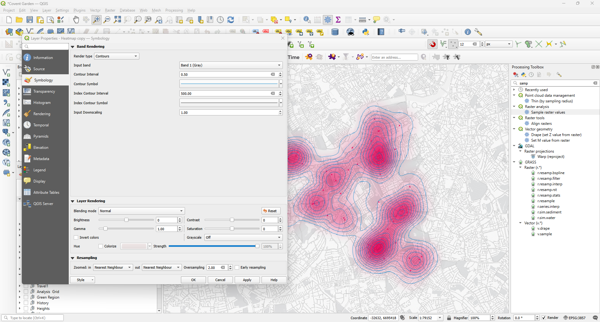
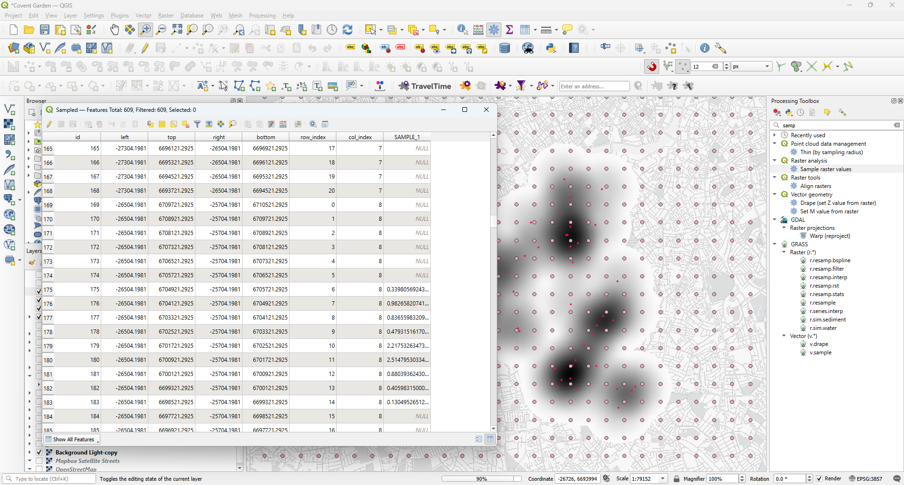
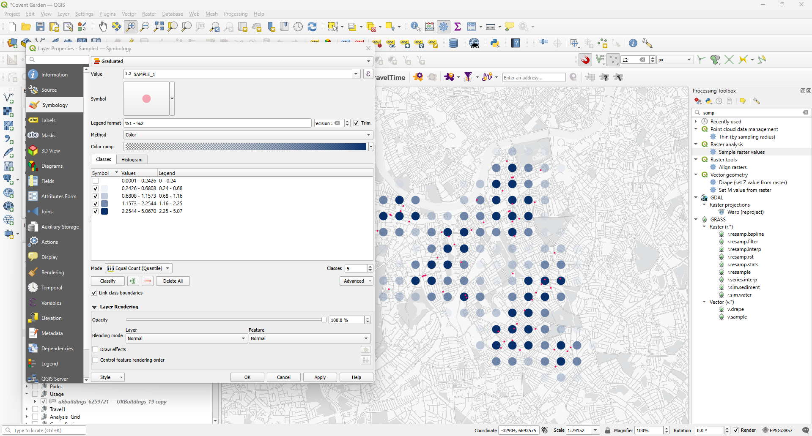
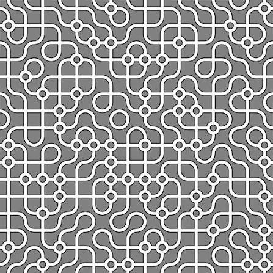
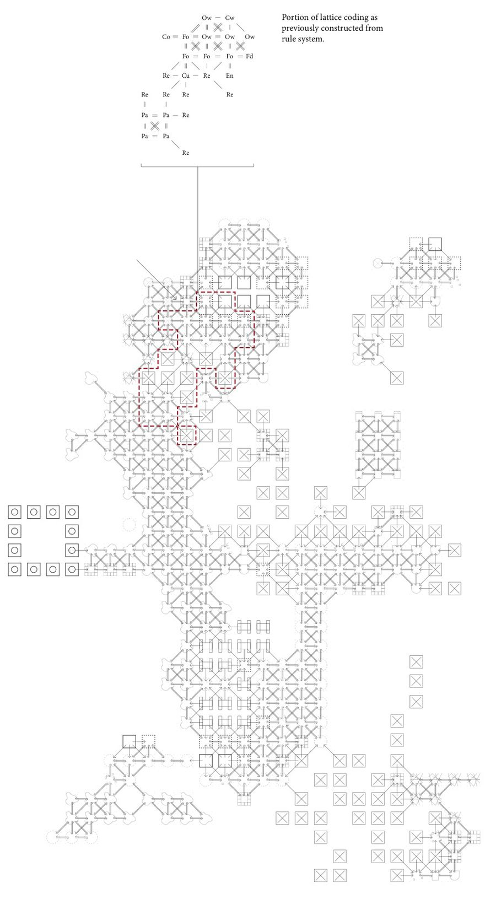
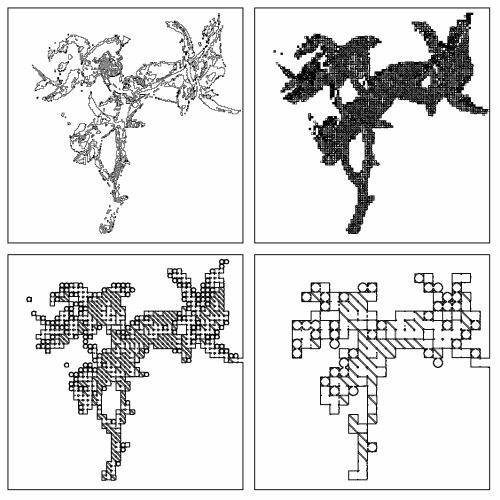
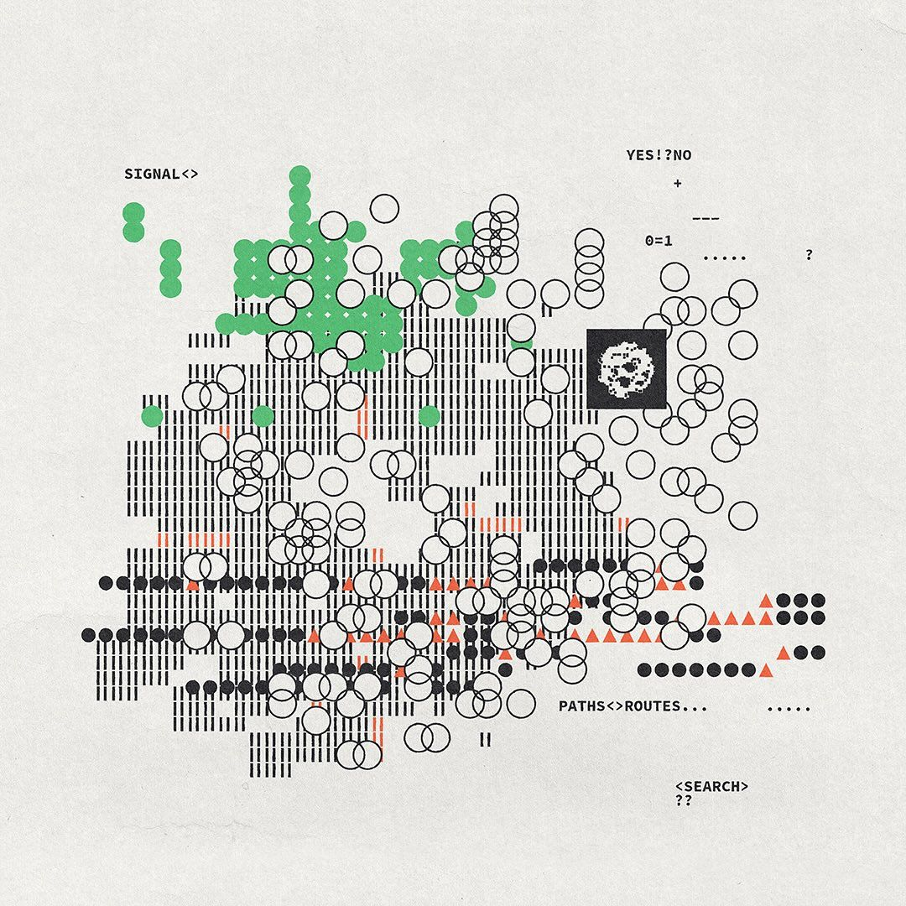
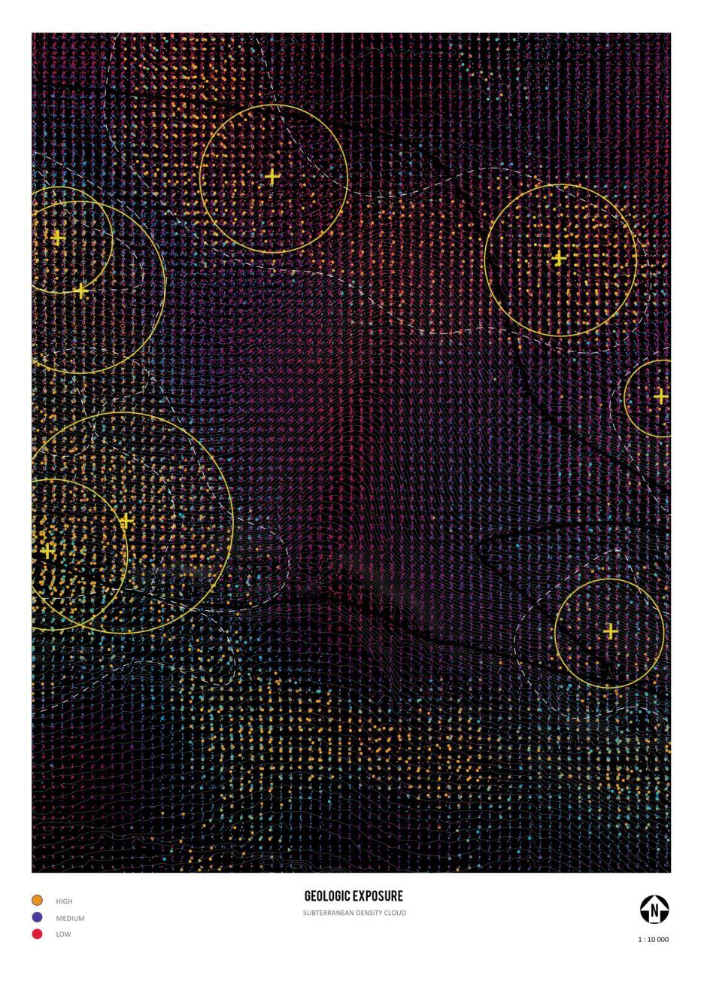

# Heatmaps in QGIS

Part of **RC15 Extended Knowledge**, a collection of tutorials and examples beyond the current curriculum.

**Software:** QGIS  
**Format:** Written tutorial  
**Software versions:** To be confirmed  
**Original collection:** Extra 07 - Heatmaps

[Browse this topic](../README.md) | [Library home](../../../README.md)

---

## Creating Density Maps from Point Data

A map of individual points can tell us where things are, but it may be difficult to see how those locations relate to one another. Where do activities cluster? Which parts of a neighbourhood have a concentration of services, and which are comparatively underserved? A **heatmap** offers one way of exploring these spatial patterns.

In this tutorial, we begin with a conventional density map in QGIS and progressively rethink how its information is represented. We will adjust the colour gradient, extract contour lines and sample values onto a regular point grid. Finally, we will use custom SVG symbols to explore how the same spatial data can produce very different graphic interpretations.

## What is a Heatmap?

A heatmap transforms a collection of point locations into a continuous surface. Each point contributes to the surrounding area, with its influence gradually decreasing over distance. Where many points are close together, their contributions overlap and the resulting values become higher.

This can make concentrations easier to recognise, but it is important to remember that the surface is **calculated**, not directly observed. Its appearance depends on choices such as the search radius, raster resolution and colour ramp. A convincing graphic therefore needs both an appropriate analytical method and careful visual communication.

### Two Methods for Creating Heatmaps

There are two main ways to generate heatmaps in QGIS:

| Method | Location | Characteristics |
|--------|----------|-----------------|
| **Processing Toolbox** | `Processing Toolbox → Interpolation → Heatmap` | Creates a static raster layer that can be saved and reused |
| **Layer Style** | `Layer Properties → Symbology → Heatmap` | Dynamic, but recalculates on every view change (slower with large datasets) |

**References:**
- [QGIS Documentation: Heatmap (Kernel Density Estimation)](https://docs.qgis.org/3.40/en/docs/user_manual/processing_algs/qgis/interpolation.html) — Processing Toolbox method
- [QGIS Documentation: Heatmap Renderer](https://docs.qgis.org/3.40/en/docs/user_manual/working_with_vector/vector_properties.html#heatmap-renderer) — Layer Style method

> **Note:** This tutorial uses the Processing Toolbox method because it is more stable and efficient when preparing graphics.


## Example: Mapping Pharmacy Density

In this example, we visualise the density of pharmacies in South East London using a point layer of pharmacy locations.


### Key Parameters

Two settings have a particularly strong influence on the result:

- **Radius** – Defines how far the influence of each point spreads. A larger radius produces smoother, more generalised results; a smaller radius highlights local clusters.
- **Resolution** – Determines the size of the raster cells. Higher resolution creates more detail but increases processing time and file size.

### Step-by-Step: Creating the Heatmap

1. Open the **Processing Toolbox** (`Processing → Toolbox` or press `Ctrl+Alt+T`)
2. Search for **Heatmap** and select `Interpolation → Heatmap (Kernel Density Estimation)`
3. Configure the settings:
   - **Input layer:** Select your point layer (e.g., pharmacies)
   - **Radius:** Set an appropriate search radius (e.g., 1000 m)
   - **Pixel size X/Y:** Set the raster cell dimensions in the layer's map units (e.g. 10 × 10 metres when using a projected CRS measured in metres), **not screen pixels**
   - **Output raster:** Choose a filename and location
4. Click **Run**


The result is a raster layer showing density values across the study area:


> **Tip:** Start with a lower resolution (larger pixel size) for testing. Increase resolution for finer graphics.


## Improving the Graphics

The initial raster is useful for analysis, but its default appearance is not necessarily the clearest way to communicate a spatial pattern. The following approaches change how we read the same underlying values, moving from a continuous colour field towards a more selective graphic language.

### 1. Editing the Colour Gradient

Start by adjusting the colour gradient. A restrained palette can make the underlying geography easier to read and help the most significant concentrations stand out.

**Steps:**

1. Right-click the heatmap layer and select **Properties**
2. Go to the **Symbology** tab
3. Select **Singleband pseudocolor** as the render type
4. Choose or customise a colour ramp
5. Adjust the **Min/Max** values and **Mode** (e.g., Equal Interval, Quantile)
6. Set transparency for low values to hide areas with minimal density
7. Click **Apply** to preview, then **OK**


**Styling tips:**

- A conventional white–yellow–red gradient can become visually dominant. Try a more restrained sequential palette.
- Make the lowest density values transparent where appropriate, allowing the base map to remain visible.
- Experiment with blending modes, but check that the resulting colours still communicate the density values clearly.

### 2. Adding Contours

Contours show lines of equal density and help clarify spatial structure.

**Steps:**

1. Open the **Processing Toolbox**
2. Search for **Contour** and select `Raster extraction → Contour`
3. Configure the settings:
   - **Input layer:** Select your heatmap raster
   - **Interval between contour lines:** Set a value (e.g., 0.0001 depending on your data range)
   - **Output:** Choose a filename
4. Click **Run**

The resulting vector layer can be styled independently:

- Adjust line weight and colour
- Label contour values
- Use different line styles for major/minor intervals

> **Tip:** The Processing Toolbox (`Ctrl+Alt+T`) provides access to all analytical tools including raster extraction, interpolation, and contour generation.

> **Tip:** For some presentation purposes, contour-like effects can also be explored through raster symbology without generating a separate contour layer.



### 3. Discrete Sample Points

A continuous surface is not always the most effective way to show density. We can instead place points on a regular grid and attach the heatmap value at each location. This gives us a set of discrete measurements that can be represented through colour, size or custom symbols, while retaining a connection to the original raster.

#### Step 1 – Create a Grid

1. Open the **Processing Toolbox**
2. Search for **Create Grid** and select `Vector creation → Create Grid`
3. Configure the settings:
   - **Grid type:** Point
   - **Grid extent:** Match your study area or use layer extent
   - **Horizontal/Vertical spacing:** Set the point interval (e.g., 150 m)
4. Click **Run**


The result is a regular grid of points:


#### Step 2 – Extract Raster Values

1. Open the **Processing Toolbox**
2. Search for **Sample Raster Values** and select `Raster analysis → Sample Raster Values`
3. Configure the settings:
   - **Input layer:** Your grid points
   - **Raster layer:** Your heatmap raster
   - **Output column prefix:** Name for the value column (e.g., "density")
4. Click **Run**


Each point now contains the heatmap value at that location:



#### Step 3 – Style the Points

With values attached to each point, you can create various visualisations:

- **Proportional symbols** – Size points by density value
- **Colour classes** – Categorise points by density ranges
- **Dot density maps** – Filter to show only high-value points



For rule-based styling with multiple conditions:


---


## Custom SVG symbols from Rhino and Grasshopper



The sampled point grid gives us more freedom than a conventional heatmap. Instead of displaying each value as a coloured dot, we can use **custom vector symbols** to create a spatial pattern. This exercise develops that idea using Rhino, Grasshopper and QGIS. The example draws on *Truchet tiles*: simple geometric elements that form more complex patterns when repeated, rotated or combined.


By changing the orientation or combination of a few quarter-circle modules, we can build much richer patterns. The aim is to understand the connection between **data, geometry and representation**. QGIS decides *which* symbol appears at each point; Rhino and Grasshopper determine *what that symbol looks like*.

### 1. Prepare the drawing in Rhino

Open the supplied [Rhino template](assets/SVG%20Template.3dm) and [Grasshopper definition](assets/SVG%20Export%20from%20rhino.gh) in Rhino 8. The definition contains a Python 3 component for exporting curves as SVG.

Work in the **World XY plane**, inside a fixed **100 × 100 drawing area centred on the origin**: X and Y each run from −50 to +50. This square is a construction guide, **not a curve that needs to be exported**. Unlike an exporter that fits every drawing to its bounding box, the fixed canvas preserves the relative size and position of your geometry.

The exporter uses the following conventions:

| Rhino geometry | SVG interpretation |
| --- | --- |
| Open line or curve | Stroke, without fill |
| Closed planar curve | Filled shape with outline |
| Nested closed curves | Transparent opening within a filled shape, using even-odd filling |
| Curved geometry | Polyline approximation in the SVG |

These are **export rules**, not Rhino object types: a closed polyline does not become a hatch in Rhino. It becomes filled because the generated SVG path has a fill property. Polylines should retain their original vertices so corners remain sharp. Smooth curves are approximated, so inspect their appearance at the intended symbol size.


### 2. Export the SVG from Grasshopper

The Python component takes curves, an output file path and an export trigger. Connect the curves you want to export to its **C** input, set that input to **List Access**, and flatten the data if you want all curves in one symbol. Supply a full `.svg` file path and press the button to write the file.

The exporter preserves the position and relative size of everything drawn inside the 100 × 100 canvas. Once imported into QGIS, you can adjust the symbol's appearance using the available fill, outline and size settings. Keep the original Grasshopper definition so you can return to Rhino and refine the geometry whenever needed.

### 3. Load the SVG as a QGIS point marker

In QGIS, right-click the sampled point layer and open **Properties → Symbology**. Select a **SVG Marker** symbol layer, browse to your exported file, and adjust its size and colours.

The SVG's **100 × 100 coordinate system does not mean 100 metres on the map**. QGIS determines the displayed marker dimensions. For graphic symbols, millimetres or pixels are often convenient. If the symbol represents an actual distance, choose **Metres at Scale** and verify the result in the map's coordinate reference system.

In particular, a project using **EPSG:3857** may give different results when measured in Cartesian map coordinates versus ellipsoidal ground distance. When checking the marker's width, distinguish between these measurement methods. Also remember that a stroke extends around its path and may slightly affect the visible extent.

### 4. Choose different SVG symbols from point data

The example point layer contains a numeric field called `p_id_count`. We can use this field to assign one of four custom SVG symbols, rather than showing all points identically.

In **Layer Properties → Symbology**, choose **Categorised**. Open the expression editor beside **Value** and enter:

```sql
CASE
  WHEN "p_id_count" IS NULL THEN 'No data'
  WHEN "p_id_count" <= 6 THEN '1 - Low'
  WHEN "p_id_count" <= 31 THEN '2 - Medium'
  WHEN "p_id_count" <= 118 THEN '3 - High'
  ELSE '4 - Very high'
END
```

Click **Classify**, then double-click each category's symbol and choose a different **SVG Marker**. You can use the supplied [OneQuarter.svg](assets/OneQuarter.svg), [TwoQuarter.svg](assets/TwoQuarter.svg), [ThreeQuarter.svg](assets/ThreeQuarter.svg) and [FourQuarter.svg](assets/FourQuarter.svg), or export your own variations.

| `p_id_count` | Category | Suggested symbol |
| --- | --- | --- |
| 0–6 | Low | One-quarter |
| 7–31 | Medium | Two-quarter |
| 32–118 | High | Three-quarter |
| 119 and above | Very high | Four-quarter |

These thresholds are **specific to this example**, not universal density thresholds. Check the distribution of values in your own data before choosing breaks. `NULL` is treated separately from a genuine count of zero.

For more control, you can alternatively use a **data-defined SVG file path** driven by a `CASE` expression. Categorised symbology is easier to understand at first because each symbol and its legend entry remain visible in the layer settings.


Here the relationship between the small set of modules and the larger mapped pattern becomes visible. Each point receives a symbol according to its count category, and the repeated geometry begins to create a continuous graphic field.

### 5. Develop the pattern


Once the data selects the symbol, experiment with **rotation, line thickness, spacing and repetition**.


 A small set of simple SVGs can generate a complex visual field. Compare the outcome with the original heatmap: where does the tile pattern reveal structure, and where does it make the data harder to interpret?

The challenge is not simply to produce an attractive image. Each graphic decision should have a legible relationship to the underlying data. If neighbouring symbols merge into continuous lines or shapes, consider whether that visual continuity communicates something meaningful or merely creates an accidental effect.

**Exercise:** Export four related symbols from Rhino, assign them to the four `p_id_count` classes, and produce two map versions: one emphasising data legibility, the other exploring a more experimental pattern. Include a legend and a short explanation of what the symbols represent.

## Beyond Standard Cartography

The custom SVG exercise demonstrates how a map can move beyond conventional colour ramps and proportional dots. Repetition, rotation and overlapping geometry can create unexpected visual relationships, but they also raise questions about legibility and interpretation. Compare your own results with the graphic references below. Which approaches could help communicate a spatial pattern, and which might obscure it?

Here are a few references for further experimentation:










