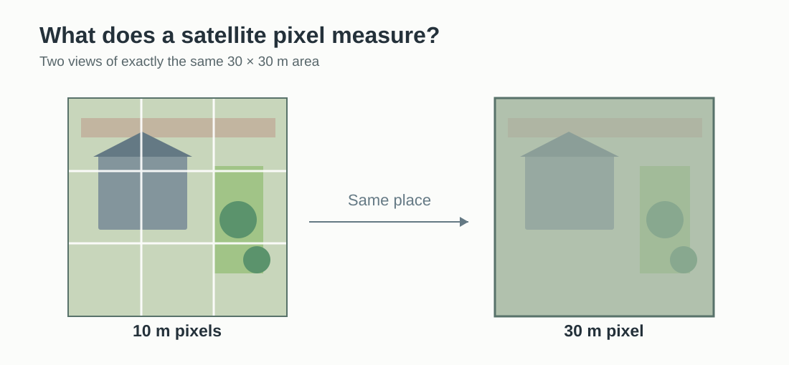
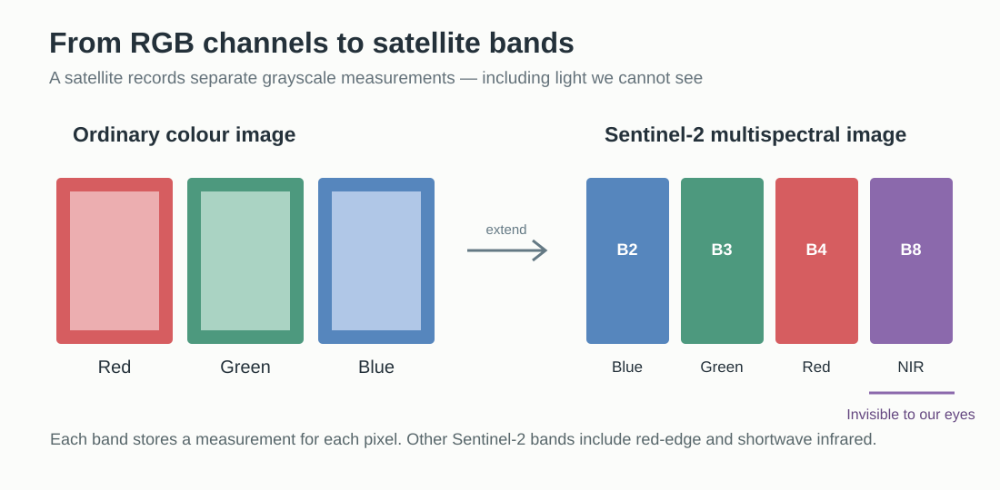

# Investigating Cities from Space
*Google Earth Engine, Python and AI-assisted coding*

[Mapping tutorials](../README.md) | [RC15 Resources](../../../README.md) | [Image credits and licences](IMAGE-CREDITS.md)

**Software:** [Google Earth Engine Code Editor](https://code.earthengine.google.com/), ChatGPT; optional QGIS and Google Colab  
**Study area:** Berlin, with a closer look at Tempelhofer Feld  
**Starting point:** No previous knowledge of the Earth Engine API or JavaScript required

> **Screenshot to add:** Finished vegetation-change map of Berlin.

Satellite imagery allows us to investigate a city beyond what we can see in an ordinary aerial photograph. We can explore vegetation, surface temperature, water and urban growth, and compare observations from different years. [Google Earth Engine](https://earthengine.google.com/) provides access to extensive collections of satellite data and processes them on Google's servers.

This tutorial is also an experiment in **AI-assisted coding**. Rather than learning every command in advance, we will discuss a spatial question with ChatGPT, copy the resulting code into Earth Engine, inspect what happens and ask follow-up questions. The goal is not to produce code as quickly as possible. It is to develop an investigation through conversation and gradually understand the decisions behind it.

We will begin in the **Earth Engine Code Editor**, which has a built-in map. Once the investigation works, we will export a georeferenced raster for QGIS and briefly look at how the same approach can continue in Python through Google Colab.

## 1. Getting started in the Code Editor

### Open Earth Engine

Visit [code.earthengine.google.com](https://code.earthengine.google.com/). Sign in with your Google account and follow the prompts to register for Earth Engine and select or create a Google Cloud project with Earth Engine enabled. Google may ask you about the intended use and project eligibility. These steps and screens can change; follow the current instructions in the browser.

The Code Editor runs JavaScript. That is fine even if you have never written JavaScript: ChatGPT can help us generate and explain each small piece of code.

> **Screenshot to add:** Code Editor, identifying script panel, Run button, map, Layers control, Console and Tasks.

### Our first map

Begin with a question you can ask ChatGPT:

> I am new to Google Earth Engine. I want to investigate Berlin using the Code Editor. Can you give me the smallest JavaScript example that centres the map on Berlin and displays the satellite basemap? Explain what each line does.

Paste the following into the Code Editor and click **Run**:

~~~javascript
// Our first map of Berlin
var berlin = ee.Geometry.Point([13.405, 52.52]);

Map.centerObject(berlin, 11);
Map.setOptions('SATELLITE');
~~~

The map moves to Berlin. This is Google's prepared satellite **basemap**: useful for orientation, but not yet an analysis of a dataset from the Earth Engine archive.

*Real Sentinel-2B image of Berlin (6 June 2018), natural colour from bands B4/B3/B2, 10 m resolution. Copernicus Sentinel data (2018)/ESA, [CC BY-SA 3.0 IGO](https://creativecommons.org/licenses/by-sa/3.0/igo/), [source](https://commons.wikimedia.org/wiki/File:Berlin_by_Senitnel-2.jpg). This is reference imagery, not the 2026 image generated in the exercise.*

> **Screenshot to add later:** Your own Code Editor showing the satellite basemap centred on Berlin.

### What is Sentinel-2, and where does satellite data come from?

Google Earth Engine does not operate its own fleet of satellites. Instead, it gives us access to imagery and other datasets collected by different space agencies and research organisations. The word **satellite imagery** covers many kinds of measurements. Some satellites observe reflected sunlight, others measure heat or use radar, and some datasets describe the elevation of the ground.

For our investigation we are using **Sentinel-2**, a European Earth-observation mission developed by the **European Space Agency (ESA)** for **Copernicus**, the Earth observation programme of the **European Union**. Sentinel-2 is a *constellation*: several satellites launched over time to maintain frequent observations. Sentinel-2A was launched in 2015, Sentinel-2B in 2017 and Sentinel-2C in 2024. The satellites carry multispectral instruments that repeatedly observe land and coastal areas. The data is openly available, making it useful for research and teaching.

*Sentinel-2A spacecraft with its solar wing deployed. Photograph: ESA/M. Pedoussaut, [CC BY-SA 2.0](https://creativecommons.org/licenses/by-sa/2.0/), [original file](https://commons.wikimedia.org/wiki/File:Sentinel-2A_satellite_-_Fully_deployed.jpg). Shown without modification.*

Sentinel-2 is only one example. Different programmes are useful for different questions:

| Data source | Who provides it? | What might we investigate? |
| --- | --- | --- |
| **Sentinel-2** | European Union Copernicus programme / ESA | Vegetation, land cover, water and urban landscapes using visible and infrared light |
| **Landsat** | NASA and the US Geological Survey (USGS), United States | Long-term landscape change using an archive extending back to the 1970s; selected Landsat instruments also measure thermal infrared radiation for land-surface temperature |
| **Sentinel-1** | European Copernicus programme / ESA | Radar observations, including floods and changes to the ground surface, even at night or through clouds |
| **SRTM elevation data** | NASA-led international radar mapping mission | Terrain elevations for studying hills, slopes and watersheds |
| **Copernicus DEM** | European Copernicus programme | Elevation and terrain analysis using a digital elevation model (DEM), rather than a conventional optical photograph |

#### Who shares satellite data?

**NASA and the US Geological Survey (USGS)** make Landsat imagery freely available to everyone. The **European Union's Copernicus programme**, working with ESA and other partners, similarly provides its Sentinel data on a free, full and open basis. The imagery is released at the sensors' actual resolution: the public Sentinel-2 images, for example, include bands with 10 m pixels. There is no normally withheld, sharper version of those same Sentinel-2 measurements reserved for internal use.

Other space agencies also share data. **Japan's JAXA** makes many Earth-observation products available through its G-Portal, while **India's ISRO** offers both openly accessible and restricted or paid products through Bhoonidhi. **China** has released selected Earth-observation datasets, including some from its Gaofen programme. However, the conditions of access differ by satellite, product and country.

Not all satellite imagery is freely available. **Commercial operators** can produce much more detailed imagery, sometimes fine enough to distinguish individual vehicles or small architectural features, but this often requires payment or a special licence. NASA and European institutions may also acquire such commercial imagery for authorised research or operational use; that does not mean their own open satellite programmes secretly retain higher-resolution versions.

For this tutorial, we use **Sentinel-2 because its data is openly available**, frequently collected and suitable for studying vegetation across an entire city. The important question when choosing a dataset is what it measures, its pixel size, its coverage through time and whether we are permitted to access and reuse it.

**Where to explore the source data:** [Copernicus Data Space](https://dataspace.copernicus.eu/) · [USGS Landsat](https://www.usgs.gov/landsat-missions/landsat-data-access) · [NASA Earthdata](https://www.earthdata.nasa.gov/) · [JAXA G-Portal](https://www.gportal.jaxa.jp/) · [ISRO Bhoonidhi](https://bhoonidhi.nrsc.gov.in/).

#### How detailed is a satellite image?

A satellite image consists of **pixels**, just like a photograph on your computer. However, the pixels also represent areas on the Earth's surface. This is called *spatial resolution*.

For Sentinel-2, the most detailed bands we use have a resolution of **10 metres per pixel**. One pixel therefore represents approximately **10 × 10 metres of ground**, or **100 square metres**. Other Sentinel-2 bands have 20 m or 60 m pixels. Landsat's commonly used multispectral bands typically have 30 m pixels, while many public elevation datasets have a grid spacing of about 30 m.

| Pixel size | Approximate ground area per pixel | What it means |
| --- | --- | --- |
| **10 m** | 100 m² | Broad patterns in parks, fields, water and neighbourhoods |
| **20 m** | 400 m² | Larger landscape features and environmental patterns |
| **30 m** | 900 m² | City-scale land cover, long-term change and terrain patterns |

Imagine a small back garden that is only 5 metres wide. A 10 m Sentinel-2 pixel might contain the garden **and** part of the house, a path or a neighbouring plot. The satellite measures their combined signal; it cannot tell us the precise condition of each object. A large square may be recognisable in the image, but we cannot zoom in to see its paving joints, benches or individual people.

**Zooming in makes the pixels bigger on the screen; it does not reveal new detail.** This is why Sentinel-2 works well for investigating vegetation across Berlin but is not a substitute for high-resolution aerial photography or a site survey.

*The same area represented by different pixel sizes. Original editable RC15 diagram; conceptual, not a satellite observation.*

Spatial resolution is only one consideration. **Temporal resolution** describes how frequently a satellite can observe the same area, while **spectral resolution** describes the kinds of light it can measure. We will encounter both concepts as we develop our analysis.

#### From RGB channels to satellite bands

A normal digital colour photograph is built from three colour **channels**: **red, green and blue (RGB)**. If you open an image in Photoshop, you can inspect each channel separately as a grayscale image. Each channel stores how much of its colour contributes to every pixel. When the three channels are displayed together, we see a full-colour photograph.

A multispectral satellite works on a similar principle, but instead of having only three visible-light channels, it records several separate ranges of wavelengths, called **bands**. You can think of each band as another grayscale measurement layer. Some record visible blue, green or red light; others record light we cannot see, such as **near-infrared** or **shortwave infrared**.

Sentinel-2 measures **13 bands**. They do not all have the same spatial resolution. For our first map, we need only these four:

| Sentinel-2 band | Measures | Pixel size |
| --- | --- | --- |
| **B2** | Blue | 10 m |
| **B3** | Green | 10 m |
| **B4** | Red | 10 m |
| **B8** | Near-infrared (invisible to our eyes) | 10 m |

By assigning B4, B3 and B2 to the red, green and blue display channels, we make a **natural-colour composite**. But we could combine other bands to highlight information not visible in an ordinary photograph. B8 will become especially useful when we calculate vegetation greenness (NDVI).

*From familiar colour channels to satellite measurements. Original editable RC15 SVG diagram.*

### Display a satellite dataset

Now ask ChatGPT:

> Can we display an actual Sentinel-2 satellite image from summer 2026 instead of the default basemap? Please explain how the bands and colour display work.

Replace the script with:

~~~javascript
// Sentinel-2 summer image of Berlin
var berlin = ee.Geometry.Point([13.405, 52.52]);

var images = ee.ImageCollection('COPERNICUS/S2_SR_HARMONIZED')
  .filterBounds(berlin)
  .filterDate('2026-06-01', '2026-09-01')
  .filter(ee.Filter.lt('CLOUDY_PIXEL_PERCENTAGE', 20));

var image = images.median();

Map.centerObject(berlin, 11);
Map.addLayer(image, {
  bands: ['B4', 'B3', 'B2'],
  min: 0,
  max: 3000
}, 'Berlin – Sentinel-2');
~~~

We have chosen **B4, B3 and B2** as our display's red, green and blue channels, just as we would combine the RGB channels of a regular photograph. The `min` and `max` values control how the measurements are stretched into screen brightness, so the result may look more saturated than a conventional aerial photograph. The `median()` operation combines observations from the selected period; the scene-level cloud filter alone does not remove every cloudy pixel.

The imagery is processed remotely. We do not need to download every original satellite scene.

*Berlin in a real Sentinel-2A false-colour image acquired 9 July 2015. Copernicus Sentinel data (2015)/ESA, [CC BY-SA 3.0 IGO](https://creativecommons.org/licenses/by-sa/3.0/igo/), [source](https://commons.wikimedia.org/wiki/File:Berlin,_Germany_ESA348055.jpg). This example is **false colour**, not the natural-colour composite produced by the script above.*

> **Screenshot to add later:** Your own 2026 Sentinel-2 natural-colour composite from the Code Editor.

## 2. Investigating vegetation change in Berlin

### From a photograph to a measurement

We have already used three visible-light bands to make a colour image. Now we can use one of Sentinel-2's **invisible** bands to ask a different question: where is vegetation growing? Plants typically absorb red light (B4) and reflect near-infrared light (B8). Their contrasting responses give us the **Normalized Difference Vegetation Index (NDVI)**:

**NDVI = (near-infrared − red) / (near-infrared + red)**

In our JavaScript, `normalizedDifference(['B8', 'B4'])` carries out this calculation for every pixel. We do not need to write the arithmetic ourselves, but it is useful to know what the command is measuring.

NDVI usually ranges between −1 and +1. High positive values often indicate active vegetation; values near zero commonly correspond to bare or built surfaces, while negative values can occur over water. NDVI is a measure of spectral greenness, **not** a direct count of trees or an exact measure of green-space area.

Ask ChatGPT:

> Can we calculate NDVI for the Berlin satellite image and show it in shades from brown to green? What do bands B8 and B4 represent?

Starting from the **Sentinel-2 script above**, add these lines at the bottom:

~~~javascript
var ndvi = image.normalizedDifference(['B8', 'B4']);

Map.addLayer(ndvi, {
  min: 0,
  max: 0.8,
  palette: ['#8c510a', '#f6e8c3', '#a6d96a', '#1a9850']
}, 'Vegetation – NDVI');
~~~

Use the **Layers** control to compare NDVI with the satellite image beneath it. Look for Tiergarten, Tempelhofer Feld and the smaller green spaces scattered across the city.

> **Screenshot to add:** NDVI map of Berlin, ideally with the Layers control visible.

### Compare two summers

A single map tells us little about change. Let's compare **summer 2018** with **summer 2025**, keeping the same months and colour scale. Ask ChatGPT:

> Can you adapt the analysis so I can compare summer NDVI in 2018 and 2025? Please filter likely clouds and cloud shadows, and let me switch between the years.

For this experiment, **replace the full previous script** with:

~~~javascript
// Berlin vegetation: 2018 versus 2025
var berlin = ee.Geometry.Point([13.405, 52.52]);

// Mask likely clouds, shadows, snow and invalid pixels.
function maskClouds(image) {
  var scl = image.select('SCL');
  var clear = scl.neq(0)
    .and(scl.neq(1))
    .and(scl.neq(3))
    .and(scl.neq(8))
    .and(scl.neq(9))
    .and(scl.neq(10))
    .and(scl.neq(11));

  return image.updateMask(clear);
}

// Calculate a summer NDVI composite for one year.
function summerNDVI(year) {
  var images = ee.ImageCollection('COPERNICUS/S2_SR_HARMONIZED')
    .filterBounds(berlin)
    .filterDate(year + '-06-01', year + '-09-01')
    .filter(ee.Filter.lt('CLOUDY_PIXEL_PERCENTAGE', 60))
    .map(maskClouds);

  return images.map(function(image) {
    return image.normalizedDifference(['B8', 'B4'])
      .rename('NDVI');
  }).median();
}

var ndvi2018 = summerNDVI(2018);
var ndvi2025 = summerNDVI(2025);

var colours = {
  min: 0,
  max: 0.8,
  palette: ['#8c510a', '#f6e8c3', '#a6d96a', '#1a9850']
};

Map.centerObject(berlin, 11);
Map.addLayer(ndvi2018, colours, 'Summer 2018', false);
Map.addLayer(ndvi2025, colours, 'Summer 2025', true);
~~~

A **function** lets us apply the same calculation to more than one year, rather than writing the entire script twice. The **SCL** band identifies likely cloud, shadow and other scene classes; excluding these helps, but it does not guarantee that every pixel is cloud-free. We have also kept the same summer months and visualisation range for a more consistent comparison.

Switch the two layers on and off. Do you see differences in Tempelhofer Feld, around Tiergarten, or in residential streets?

> **Screenshot to add:** Comparison of 2018 and 2025 using the same legend.

### Map the difference directly

Switching layers is useful, but Earth Engine can calculate the difference for us. Ask ChatGPT:

> Can we subtract the 2018 NDVI from the 2025 NDVI? Please make decreases red, little change white and increases green.

**Add** this code to the end of the 2018/2025 script:

~~~javascript
var change = ndvi2025.subtract(ndvi2018);

Map.addLayer(change, {
  min: -0.3,
  max: 0.3,
  palette: ['#b2182b', '#f7f7f7', '#1a9850']
}, 'Vegetation change 2018–2025');
~~~

A pixel changing from NDVI 0.3 to 0.6 produces **+0.3** (green); one changing from 0.6 to 0.3 produces **−0.3** (red). The colour range is a display choice, not a threshold that defines vegetation loss.

> **Screenshot to add:** Red–white–green NDVI difference map, focused on Tempelhofer Feld.

**Stop and interpret.** A difference map shows a change in the satellite-derived vegetation signal. It does not automatically prove that trees were planted, buildings replaced a park, or green space disappeared. Rainfall, irrigation, mowing, crop or grass cycles, atmospheric effects and the selection of images can all influence NDVI. Before making strong claims, investigate several years, check the available observations and compare the result with independent sources.

Try asking ChatGPT: *Could the difference be caused by a particularly dry summer? How could we test that?*

### Export the analysis

Now we will take the result out of Earth Engine. A **GeoTIFF** stores pixel values together with information about their geographic position. Unlike a screenshot, it remains useful for spatial analysis in other software.

Ask ChatGPT:

> How can I export the actual NDVI difference values around Tempelhofer Feld as a GeoTIFF to Google Drive? I want to open the data in QGIS, not just save a coloured image.

**Add** this code below the difference-map code:

~~~javascript
// Export an area around Tempelhofer Feld.
var tempelhof = ee.Geometry.Point([13.403, 52.473])
  .buffer(4000)
  .bounds();

Map.centerObject(tempelhof, 12);

Export.image.toDrive({
  image: change.rename('NDVI_change'),
  description: 'Berlin_NDVI_Change_2018_2025',
  folder: 'EarthEngine',
  region: tempelhof,
  scale: 10,
  fileFormat: 'GeoTIFF',
  maxPixels: 1e9
});
~~~

Click **Run**, open the **Tasks** tab, then start the export task and confirm its settings. When processing finishes, find the resulting TIFF in the **EarthEngine** folder in Google Drive and download it. The export is limited to an area around Tempelhofer Feld to keep the file manageable; the 10 m export scale does not create detail beyond that available in the source observations.

> **Screenshots to add:** Earth Engine Tasks panel; resulting GeoTIFF in Google Drive.

### Display the result in QGIS

Open QGIS and drag the downloaded GeoTIFF onto the map. You can use **Layer Properties → Symbology → Singleband pseudocolor** to create a diverging colour ramp: red for negative values, white around zero, green for positive values. Set the range approximately to **−0.3 to +0.3**, with **0** at the centre, as in Earth Engine. Add a suitable basemap to see streets, neighbourhoods and park boundaries beneath the analysis.

The raster contains numbers such as −0.18 or +0.12, not red or green colours. QGIS decides how those numbers are displayed. Use the Identify tool to inspect a pixel, and check **Layer Properties → Information** for the layer's CRS, extent and pixel size. QGIS can reproject layers for display, but that does not alter the underlying data.

> **Screenshot to add:** Exported raster styled over a Berlin basemap in QGIS.

We have moved from a research question to a satellite-derived dataset that can be combined with our existing mapping and design workflows. For more detail about QGIS raster display and coordinate reference systems, see the other [mapping tutorials](../README.md).

## 3. Continuing in Python with Google Colab

The Earth Engine Code Editor is a useful starting point because the script and map sit together. Once we understand the investigation, we can use the **same Earth Engine datasets and operations** through Python in a [Google Colab notebook](https://colab.research.google.com/).

This is a change of programming interface, not a new satellite data source. Python can be convenient when we want to combine geospatial work with data tables, charts or other analysis libraries. Unlike the Code Editor, Colab requires explicit Earth Engine authentication and initialisation with an Earth Engine-enabled Cloud project.

For now, we do not need to reproduce the whole tutorial. Start with a new Colab notebook and ask ChatGPT:

> We have compared summer NDVI in Berlin using JavaScript in the Google Earth Engine Code Editor. Can you help me translate the analysis to Python in Google Colab, one cell at a time? Begin with authentication and showing a map. Explain differences from JavaScript only when they matter.

A starting cell is:

~~~python
import ee

ee.Authenticate()
ee.Initialize(project='YOUR_CLOUD_PROJECT_ID')
~~~

Replace the placeholder with the ID of your own Earth Engine-enabled Google Cloud project. Follow the authentication prompts. To display an interactive map, ask ChatGPT to introduce a notebook mapping library such as **geemap**, including any installation steps required for your Colab session.

> **Screenshot to add (optional):** Colab notebook with code and an interactive map.

For help moving data between Colab, Google Drive and your computer, see [File Access in Google Colab](../../programming-and-data-access/file-access-in-google-colab/README.md).

## 4. Where could we go next?

We have only begun to explore Earth Engine. The most interesting next step is not necessarily another command; it is **another question**. Here are some directions worth investigating with ChatGPT:

- **Animated vegetation time series.** Instead of comparing two summers, calculate NDVI for many years and animate the maps. Does an apparent trend persist, or does it fluctuate with the weather? Ask how to export an animation and how to keep its colour scale consistent.
- **Urban surface temperature.** Use a suitable Landsat thermal product to compare parks and built-up areas. Remember that satellite-derived *land surface temperature* is not the same as air temperature.
- **Water and flooding.** Explore changing water extent with optical imagery or Sentinel-1 radar. Investigate why radar can be helpful when clouds obscure the ground.
- **Urban expansion.** Compare built-up or land-cover datasets over time, then examine what their spatial resolution can and cannot show.
- **Seasonal change.** Compare spring, summer and autumn vegetation in the same year. How much of what looked like long-term change is actually seasonal?
- **Compare cities.** Repeat an analysis for London, Berlin or another city, while considering whether the same methods and time windows are appropriate.
- **Measure and chart.** Instead of only producing coloured maps, calculate average NDVI inside a defined area and plot a time series. How does the result change if the study boundary changes?

The [Earth Engine Data Catalog](https://developers.google.com/earth-engine/datasets/catalog) is a useful place to discover other datasets. You do not have to read it cover to cover. Use it when a particular question makes a dataset relevant, and ask ChatGPT to help you assess its resolution, time coverage and limitations.

### Working with ChatGPT

You do not need to memorise every Earth Engine command or read endless documentation before starting. Describe what you want to investigate, run a small example, show ChatGPT the outcome or error, and continue the discussion. Ask for explanations whenever the code introduces an unfamiliar idea.

But **working code is not the same as reliable evidence**. Check what a dataset measures, whether the time periods are comparable, how missing or cloudy observations are handled, and whether the visualisation supports your interpretation. The conversation can help you ask better questions; it cannot replace your judgement about the answers.

---

**Background reading:** [ESA: Sentinel-2](https://www.esa.int/Applications/Observing_the_Earth/Copernicus/Sentinel-2) · [Copernicus: Sentinel-2 bands and resolution](https://dataspace.copernicus.eu/data-collections/copernicus-sentinel-missions/sentinel-2) · [NASA: Landsat 8](https://science.nasa.gov/mission/landsat-8/) · [Copernicus DEM](https://documentation.dataspace.copernicus.eu/APIs/SentinelHub/Data/DEM.html)

**Useful links:** [Earth Engine Code Editor](https://code.earthengine.google.com/) · [Earth Engine Data Catalog](https://developers.google.com/earth-engine/datasets/catalog) · [Earth Engine Guides](https://developers.google.com/earth-engine/guides) · [Google Colab](https://colab.research.google.com/)

*This resource is designed as a starting point for experimentation. Screenshots will be added to illustrate the stages of the workflow.*