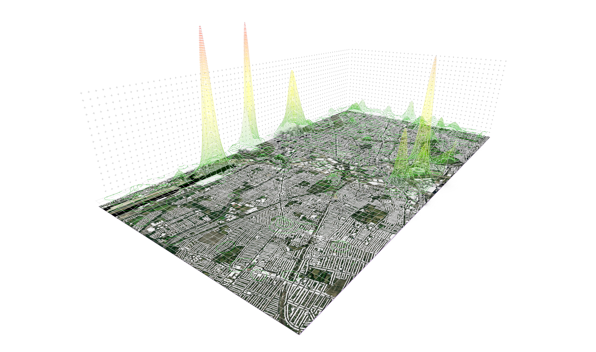

# Sentiment Landscapes

[Browse this topic](../README.md) | [Library home](../../../README.md)

Initial transfer from the [source Google Drive folder](https://drive.google.com/drive/folders/1Vne2oIm3IZLKmHETGs8oMA8x86V2IqWA). Original filenames and internal structure are preserved.

**Start here:** [Chapter 1 — From Points to Landscapes](01-introduction.md). The [earlier technical draft](TUTORIAL.md) remains available as reference while the practical chapters are developed.

**Continue:** [Chapter 2 — Collecting Flickr Data in QGIS](02-collecting-flickr-data.md) — install the plugin, obtain an API key and collect geolocated photographs.

**Next:** [Chapter 3 — Analysing Spatial Density in QGIS](03-spatial-density-qgis.md) — create a grid, count photographs and export centroids for Grasshopper.

**Chapter 4:** [Building a 3D Landscape in Grasshopper](04-grasshopper-landscape.md) — import centroids with Heron, map counts to height and construct a surface.

**Looking for a missing file?** [Files not transferred — locations and Drive download links](FILES-NOT-TRANSFERRED.md).

## Contents

- `Qgis/SenitmentLandscapes.qgz`: QGIS project (original spelling), smaller GeoPackages, CSV data, metadata and PDF exports.
- `Rhino/`: Grasshopper definitions and smaller assets.
- `Illustrator/`: Illustrator and Photoshop working files.
- `Images/`: illustrations, screenshots and image working files.
- `assets/`, `Background.png` and `london_photos.csv`: supporting data, maps and imagery.

This example collection explores photo locations, spatial aggregation and landscape visualisation with QGIS, Rhino/Grasshopper and Illustrator. Familiarity with these applications is assumed. A first step-by-step tutorial draft now records intermediate-level exercises and the package versions found in the source definition. Application testing and tutorial polishing remain to be completed. Author and teaching year are unconfirmed; source files date from 2025. Transfer integrity checked on 25 October 2026; application compatibility has not been tested.

## Existing Rhino output image

Use the existing [landscape view capture](Images/ViewCapture20250712_174129.png) instead of the omitted Rhino model.

QGIS screenshots are also retained in `Images/`.

## Omitted dependencies

For a quick lookup, open [Files not transferred — locations and Drive links](FILES-NOT-TRANSFERRED.md). These seven files remain in Drive and were not changed or deleted. Paths are relative to this folder. Restore a required dependency to its exact path from the linked Drive original.

| Original path | Bytes | Reason | Drive original |
| --- | ---: | --- | --- |
| `Rhino/Heron.3dm` | 480915860 | Use existing view capture | [Download from Drive](https://drive.google.com/file/d/1K4rqx5xuuKpZ0KahsIEO455y4-jl5weX/view?usp=drivesdk) |
| `Rhino/Heron.3dmbak` | 469661251 | Backup omitted | [Download from Drive](https://drive.google.com/file/d/1airGamHQJt_2p3F1jPsS5Cv2Pnp9k5or/view?usp=drivesdk) |
| `Qgis/PhotoPTS.gpkg` | 174866432 | Large dependency omitted | [Download from Drive](https://drive.google.com/file/d/1aXWNjdYsIX8YJsLo84TNNKk5YG5ztaEZ/view?usp=drivesdk) |
| `Qgis/FlickrImages.sqlite` | 245280768 | Large dependency omitted | [Download from Drive](https://drive.google.com/file/d/1B6Tt1XXuQoTQBqKMNdaq1pd5nS7cILyl/view?usp=drivesdk) |
| `assets/greater-london-latest.osm.pbf` | 112564816 | Large dependency omitted | [Download from Drive](https://drive.google.com/file/d/1X8aBtxc52SNWSXWUzFbI-niD3dgIaTko/view?usp=drivesdk) |
| `Rhino/assets/large.osm` | 141022585 | Large dependency omitted | [Download from Drive](https://drive.google.com/file/d/13yCud08c6-Ul2xng_1u2dgtiEfclG9GB/view?usp=drivesdk) |
| `assets/greater-london-latest.osm/greater-london-latest.osm` | 1960670612 | Large dependency omitted | [Download from Drive](https://drive.google.com/file/d/1IWMFh_kUqE9BoWqdaKF1b746MAgYjLSs/view?usp=drivesdk) |

No external download URL for the large London OSM file has been verified, so none is asserted. The Drive original is the reference copy; a current extract may differ.

QGIS and Grasshopper may require manual relinking of source paths. The QGIS project is not self-contained without its omitted databases. See [transfer notes](TRANSFER.md) for the inspected path dependencies and [file manifest](TRANSFER-MANIFEST.csv) for every source file, size, Drive link and included-file SHA-256 checksum.

## Provenance and review

Repeated assets in separate source folders are retained to preserve references. Git does not store the empty `Illustrator/1x/` directory; the empty `assets/greater-london-latest.osm/` directory is recreated when restoring its omitted file.

Third-party data and imagery licences and credits remain to be established. Filenames indicate OpenStreetMap and Flickr inputs; review actual attribution and reuse terms. This README grants no additional licence.
