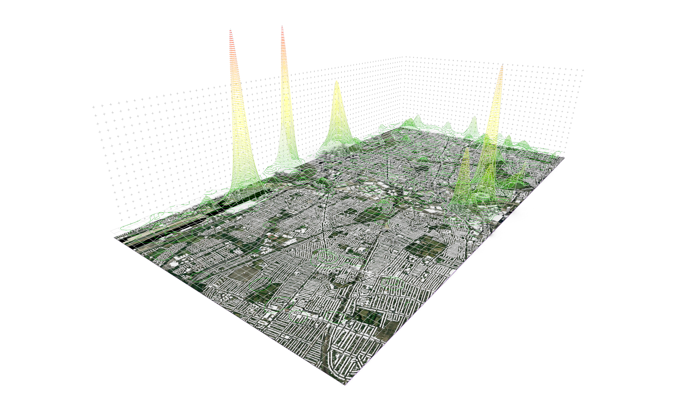

# Density Landscapes

[Mapping and spatial analysis](../README.md) · [RC15 Resources](../../../README.md)

Turn geographical observations into an artificial landscape. This tutorial explains a **transferable method**: collect or import point data, count observations within a grid, use the values to construct a three-dimensional surface, and develop a drawing that makes the spatial pattern legible.

*An example from the archived project. Your landscape will differ according to your data, study area, grid and height mapping.*

We use geolocated Flickr photographs in London as an example, but the method can be adapted to other datasets with suitable locations and numerical values. The aim is **not to reproduce this particular image or dataset**, but to learn how data can become a spatial representation.

**Software:** QGIS, Rhino/Grasshopper with Heron, Adobe Illustrator  
**Prerequisites:** Familiarity with QGIS layers and basic Grasshopper definitions  
**Format:** Five connected chapters, with example project files and an earlier technical reference  
**Verification:** Partially verified in practice (confirmed by the maintainer on 14 November 2026). Complete reproducibility of the archived multi-application project and its external dependencies has not been established.

## Follow the method

1. **[From Points to Landscapes](01-introduction.md)** — Understand how spatial aggregation can create an artificial topography.
2. **[Collecting Flickr Data in QGIS](02-collecting-flickr-data.md)** — Obtain geolocated photo records; use the supplied data if live collection is unavailable.
3. **[Analysing Spatial Density in QGIS](03-spatial-density-qgis.md)** — Count observations in grid cells and export their centres and values.
4. **[Building a 3D Landscape in Grasshopper](04-grasshopper-landscape.md)** — Position the points geographically, map counts to heights and construct a surface.
5. **[Representing the Landscape — From Rhino to Illustrator](05-representing-the-landscape.md)** — Add geographic context, generate contours and compose a drawing.

A different location, date of collection or grid size will produce different results. Even the included `london_photos.csv` is not the dataset behind all the original project outputs: it contains 61,250 photograph records, while the archived centroid counts sum to 517,804. **These figures have not been reconciled**, so do not expect the smaller CSV to reproduce the original heightfield. This does not prevent you from using it to learn the method.

## Archived project and supporting files

The source project was originally called *Sentiment Landscapes*, but the exercises analyse **photograph density**, not sentiment. Original directory and project filenames are retained to preserve links and dependencies. The [earlier technical draft](TUTORIAL.md) documents the archived source and its recorded software versions; it is a reference, not a separate required tutorial.

The original material was transferred from [Google Drive](https://drive.google.com/drive/folders/1Vne2oIm3IZLKmHETGs8oMA8x86V2IqWA). Included files are arranged as follows:

- `Qgis/` — the original `SenitmentLandscapes.qgz` (historical filename), smaller GeoPackages, CSV data, metadata and PDF exports.
- `Rhino/` — Grasshopper definitions and smaller associated assets.
- `Illustrator/` — Illustrator and Photoshop project files.
- `Images/` — screenshots and reference images.
- `assets/`, `Background.png` and `london_photos.csv` — other supporting material.

Some large files were deliberately not committed to GitHub. **You do not need to restore the entire archive to work through the method**, particularly if you create your own QGIS point data and Grasshopper definition. If you want to open the original project, consult the [missing-file list](FILES-NOT-TRANSFERRED.md), [transfer notes](TRANSFER.md) and [file manifest](TRANSFER-MANIFEST.csv).

## Omitted dependencies

For a quick lookup, open [Files not transferred — locations and Drive links](FILES-NOT-TRANSFERRED.md). These seven files remain in Drive and were not changed or deleted. Paths are relative to this folder. Restore a required dependency to its exact path from the linked Drive original.

| Original path | Bytes | Reason | Drive original |
| --- | ---: | --- | --- |
| `Rhino/Heron.3dm` | 480915860 | Use existing view capture | [Download from Drive](https://drive.google.com/file/d/1K4rqx5xuuKpZ0KahsIEO455y4-jl5weX/view?usp=drivesdk) |
| `Rhino/Heron.3dmbak` | 469661251 | Backup omitted | [Download from Drive](https://drive.google.com/file/d/1airGamHQJt_2p3F1jPsS5Cv2Pnp9k5or/view?usp=drivesdk) |
| `Qgis/PhotoPTS.gpkg` | 174866432 | Large dependency omitted | [Download from Drive](https://drive.google.com/file/d/1aXWNjdYsIX8YJsLo84TNNKk5YG5ztaEZ/view?usp=drivesdk) |
| `Qgis/FlickrImages.sqlite` | 245280768 | Large dependency omitted | [Download from Drive](https://drive.google.com/file/d/1B6Tt1XXuQoTQBqKMNdaq1pd5nS7cILyl/view?usp=drivesdk) |
| `assets/greater-london-latest.osm.pbf` | 112564816 | Large dependency omitted | [Download from Drive](https://drive.google.com/file/d/1X8aBtxc52SNWSXWUzFbI-niD3dgIaTko/view?usp=drivesdk) |
| `Rhino/assets/large.osm` | 141022585 | Large dependency omitted | [Download from Drive](https://drive.google.com/file/d/13yCud08c6-Ul2xng_1u2dgtiEfclG9GB/view?usp=drivesdk) |
| `assets/greater-london-latest.osm/greater-london-latest.osm` | 1960670612 | Large dependency omitted | [Download from Drive](https://drive.google.com/file/d/1IWMFh_kUqE9BoWqdaKF1b746MAgYjLSs/view?usp=drivesdk) |

No external download URL for the large London OSM file has been verified, so none is asserted. The Drive original is the reference copy; a current extract may differ.

QGIS and Grasshopper may require manual relinking of source paths. The QGIS project is not self-contained without its omitted databases. See [transfer notes](TRANSFER.md) for the inspected path dependencies and [file manifest](TRANSFER-MANIFEST.csv) for every source file, size, Drive link and included-file SHA-256 checksum.

## Provenance and review

Repeated assets in separate source folders are retained to preserve references. Git does not store the empty `Illustrator/1x/` directory; the empty `assets/greater-london-latest.osm/` directory is recreated when restoring its omitted file.

Third-party data and imagery licences and credits remain to be established. Filenames indicate OpenStreetMap and Flickr inputs; review actual attribution and reuse terms. This README grants no additional licence.
