# LED Control with vvvv and Arduino

Part of **RC15 Resources**, the permanent tutorial library for Pervasive Urbanism.

**Software:** Arduino, vvvv; optional Python / Grasshopper  
**Format:** Written tutorial  
**Software versions:** Original board and vvvv version not confirmed; serial protocol is general. Python example requires compatible Python 3 and pySerial.  
**Original collection:** Extra 12 - LED Control

[Browse this topic](../README.md) | [Library home](../../../README.md)

---

# Controlling a Series of LEDs with vvvv and Arduino

## Introduction

This tutorial explains how to control a series of LEDs directly from vvvv. We will work with a row of 8 LEDs and explore how to control each LED individually, as well as how to program sequences and patterns.

This method is intentionally simple and abstract. Its underlying idea can be extended to other outputs, although motors, servos and relays require different power supplies, drivers and safety considerations; do not connect them directly as if they were LEDs.

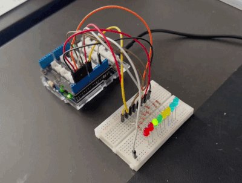

### Firmata vs Serial Communication

There are multiple ways to control an Arduino from a computer. One common approach is to use **Firmata**, which allows direct control of Arduino pins from software such as Python, Grasshopper (Python), or vvvv.

In this setup, the Arduino acts mainly as a relay, while the logic runs on the computer. However, in practice this approach can be less robust. Each board requires a specific Firmata setup, and initial tests showed inconsistent and unreliable behaviour.

This tutorial instead uses an explicit **serial message protocol**: the computer sends eight binary characters followed by a newline; the Arduino validates the message and updates its outputs. This is simple to inspect and reproduce, but reliability still depends on correct port settings, message framing and wiring.

The same protocol can be used by any software capable of sending serial bytes, including vvvv or Python. We provide a small reusable Python example at the end.

In this tutorial, we use vvvv because it provides a clear and flexible interface for generating and sending control data.

### Core Concept

The system is based on sending an 8-character string to the Arduino. Each character represents the ON/OFF state of one LED.

Examples:

* `00000000` → all LEDs OFF
* `11111111` → all LEDs ON
* `10000000` → only the first LED ON

Every message **must end with a newline character** (`\n`). For example, the first pattern is transmitted as the nine bytes `10000000\n`: eight states plus one terminator. This framing tells the Arduino when a complete command has arrived. It forms the basis for more complex behaviours.


## Arduino

The hardware setup is simple: each digital pin drives one LED. Pins 0 and 1 should not be used, as they may interfere with serial communication.

### Wiring

| LED | Arduino Pin |
| --- | ----------- |
| 1   | D2          |
| 2   | D3          |
| 3   | D4          |
| 4   | D5          |
| 5   | D6          |
| 6   | D7          |
| 7   | D8          |
| 8   | D9          |

**Each LED needs its own current-limiting resistor** (for example 220–330 Ω for a typical 5 V Arduino demonstration with standard small LEDs; choose the value for the actual LED and board). Connect each Arduino output pin **through its own resistor** to the LED **anode** (longer leg on many standard LEDs); connect each LED **cathode** (shorter leg / flat side on many LEDs) to GND. Never connect an LED directly between an output pin and GND without a suitable resistor. Check the board's per-pin and total current limits before powering the circuit. If you use a 3.3 V board or unusual LEDs, calculate the resistor value again.

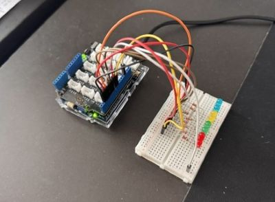

### Arduino Code

The sketch collects a command one character at a time and updates the LEDs **only if it receives exactly eight `0` or `1` characters followed by a newline**. It also accepts an optional carriage return (`\r`) before the newline, as some serial tools transmit `\r\n`.

```cpp
const byte ledPins[8] = {2, 3, 4, 5, 6, 7, 8, 9};
char command[8];
byte count = 0;
bool invalid = false;

void setup() {
  Serial.begin(9600);
  for (byte i = 0; i < 8; i++) {
    pinMode(ledPins[i], OUTPUT);
    digitalWrite(ledPins[i], LOW);
  }
}

void loop() {
  while (Serial.available() > 0) {
    char c = (char)Serial.read();

    if (c == '\r') {
      continue;  // Accept CRLF as well as LF.
    }

    if (c == '\n') {
      if (!invalid && count == 8) {
        for (byte i = 0; i < 8; i++) {
          digitalWrite(ledPins[i], command[i] == '1' ? HIGH : LOW);
        }
      }
      count = 0;       // Start collecting the next message.
      invalid = false;
    } else if (!invalid) {
      if ((c == '0' || c == '1') && count < 8) {
        command[count++] = c;
      } else {
        invalid = true;  // Ignore this message until newline.
      }
    }
  }
}
```

**Why validate the message?** Without checking length and contents, a truncated command might change some LEDs or an unexpected character might be treated as OFF. Here an incomplete or malformed line is ignored, and the last valid LED state is retained. The sketch does not need a `String` object or a blocking read timeout.

Test the circuit before opening vvvv: in Arduino IDE's Serial Monitor, choose **9600 baud** and a line-ending setting of **Newline** (or **Both NL & CR**). Send `10000000` in the text field; the monitor appends the line ending. Only the first LED should illuminate. Then test `00000000` and `11111111`. Close Serial Monitor before connecting from vvvv: generally only one application can own a serial port at a time.

## VVVV

We send an eight-character state string from vvvv, followed by a newline (the ninth transmitted byte):

```
10100001
```

Each of the **first eight characters** corresponds to one LED:

* `1` → ON
* `0` → OFF

---

### vvvv Setup

At its core, the vvvv setup is as simple as the screenshot below: 

File: *01 Serial Communication.vl*

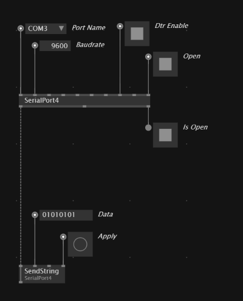

The **SerialPort4** node establishes communication with the Arduino. Set it to the Arduino's serial port and **9600 baud** (matching `Serial.begin(9600)`). Send the state string with a **newline terminator** (LF, character code 10): how you append this depends on how the particular vvvv node formats its outgoing text. Verify that the actual bytes sent are the eight states plus LF, rather than relying on a visible line break in the IOBox. Trigger the send action with **Apply** and check the LEDs. Disconnect the Arduino Serial Monitor before using the port from vvvv. 

The photograph below shows the result of the `10000000` command.


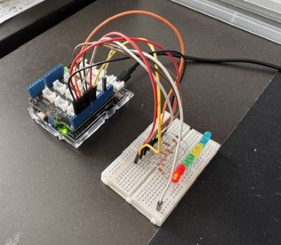

#### Play sequences

File: *02 Serial Communication.vl*

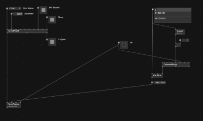

This is an extension of the previous setup that allows you to play animations or sequences. On the right-hand side of the patch, a list of strings defines different LED states. A counter generates an index, and based on this index, the corresponding string is selected and sent to the Arduino.

Press "Up" to step through the sequence manually.

The next screenshot shows an LFO node that advances the sequence automatically. Each selected state still needs its newline terminator when transmitted.

File: *03 Serial Communication.vl*

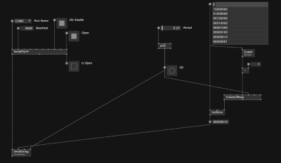

#### Creating Spreads
It may not be immediately clear how to create spreads of strings, as shown in the screenshot above. The following steps explain the process.

First, create a generic IOBox:

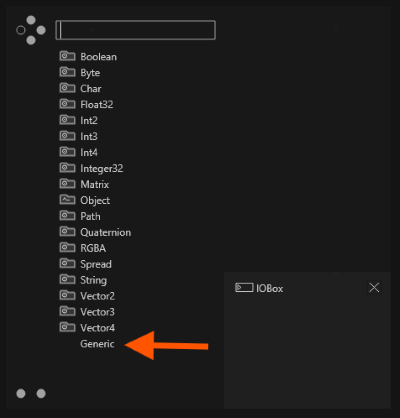


Right-click on the IOBox, select Configure, and set the type to String:

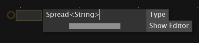


Then continue configuring the IOBox:

* Enable Max Visible Entries
* Enable Show Values
* Adjust the number of entries either in the configuration or directly in the top-left corner of the IOBox

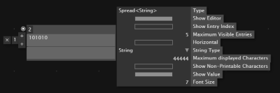


This is generally all you need to play simple LED animations. If you get no response, confirm that the COM/serial port is correct, no other program has it open, the baud rate matches, each message ends with LF, and the LEDs have individual resistors with the correct polarity. 

--- 

### EXTRA: Combining Strings in vvvv

File: *04 Serial Communication.vl*

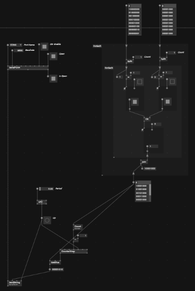

This allows layering of control logic.

This example patch shows how to combine different animation sequences. For example, one LED can move across the array while another remains fixed. Both sequences can be merged into a single output.

Example:
```
10000000
00000001
```
Combines to
```
10000001
```

While the same animation could be written directly as one sequence, that is not the point here. The focus is on building more complex behaviours from simple base patterns.

The combining logic can then be encapsulated into a process node. This allows you to chain multiple patterns together, switch between base patterns, or build increasingly complex animations in a modular way.

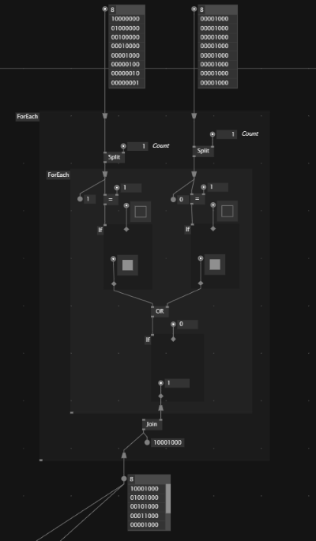

## Optional — Control the same LEDs from Python

The serial protocol is deliberately independent of vvvv. The accompanying [`led_serial.py`](led_serial.py) file offers two reusable functions:

- `encode_states(states)` takes eight values (for example `[1, 0, 0, 0, 0, 0, 0, 1]`) and returns the nine bytes `b"10000001\n"`. It checks that the input is valid.
- `send_states(port, states)` writes that message to an **already open** serial port. The function does not open a new connection each time, which makes it suitable for animation loops.

### Run it as a standalone program

Install the [pySerial library](https://pyserial.readthedocs.io/en/latest/pyserial.html) in your Python environment:

```bash
python -m pip install pyserial
```

Close the Arduino Serial Monitor and identify the Arduino's port in Arduino IDE. With the sketch uploaded and the circuit connected, run the example from the same directory as the script:

```bash
python led_serial.py COM3
```

Replace `COM3` with the correct port (for example `/dev/ttyACM0` on some Linux systems or `/dev/cu.usbmodem...` on macOS). The script sends a simple one-LED-at-a-time animation, then turns all LEDs off. Opening the serial connection may reset the Arduino; the example includes a short startup pause.

### Reuse the function in another Python script

```python
import serial
from led_serial import send_states

with serial.Serial("COM3", 9600, timeout=1, write_timeout=1) as board:
    # Allow the board to restart if opening the port resets it.
    import time
    time.sleep(2)
    send_states(board, [1, 0, 1, 0, 0, 0, 0, 1])
```

### Possible Grasshopper integration

A **Python 3 / CPython** scripting component in a compatible Rhino/Grasshopper environment could import `encode_states` and `send_states` (with the file on its Python import path). If you wish to send directly from Grasshopper, that Python environment must have **pySerial** installed and access to the operating system's serial port. Legacy **IronPython** environments do not necessarily support the same package installation steps.

Keep a serial connection **persistent** rather than reopening it every time Grasshopper recomputes. Send a command only in response to a deliberate button or changed state, and close the port when finished. For a simpler first experiment, use Grasshopper to generate the eight values, then pass them to a **separate standalone Python process** that owns the serial connection.

This is an optional starting point, not a tested Grasshopper definition. The Python command formatting can be checked without hardware; the actual board, USB port and Grasshopper environment still need testing.

## Troubleshooting

| Symptom | What to check |
| --- | --- |
| No LEDs respond | Check USB/COM port, 9600 baud, common GND, LED polarity and individual resistors |
| Nothing changes after a command | Ensure every message ends in `\n`; the Arduino waits for a complete line |
| Some patterns are ignored | Commands must contain **exactly eight** binary characters before the newline |
| Python or vvvv cannot open the port | Close Serial Monitor or other software that may already be connected |
| Python stops with `ModuleNotFoundError: serial` | Install `pyserial` in the same Python interpreter running the script |
| LEDs behave differently from expected | Confirm the D2–D9 pin order and match `0`/`1` positions to the wiring |

**Editorial note (27 October 2026):** Wiring guidance, message validation and language were revised, and a reusable Python example was added. The existing vvvv patches and hardware have not been retested during this review.
