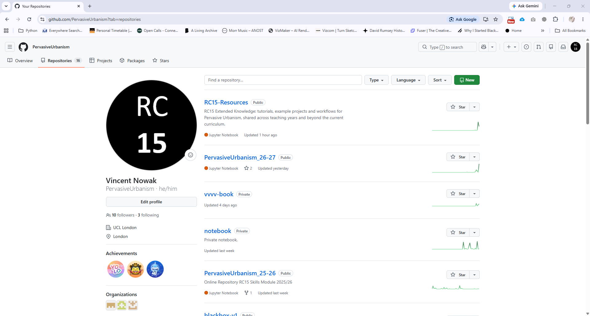
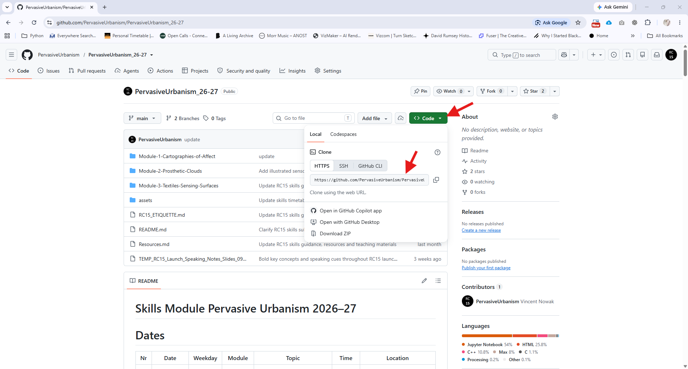
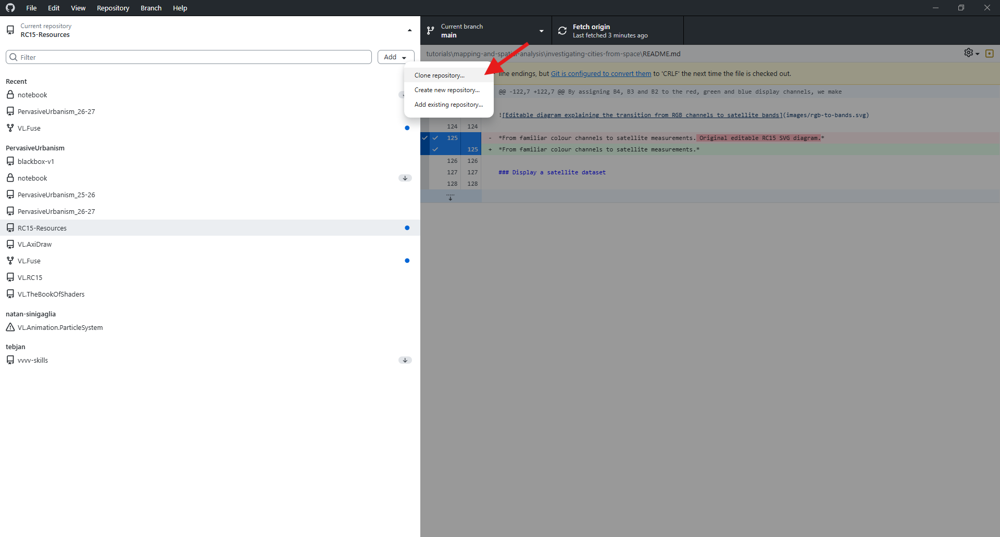
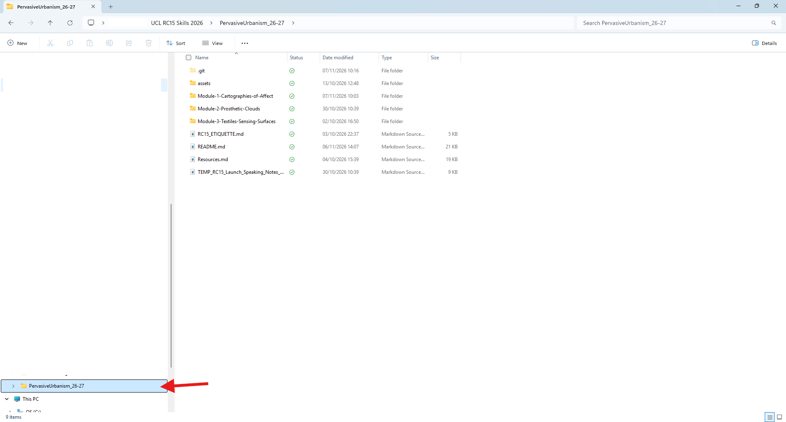
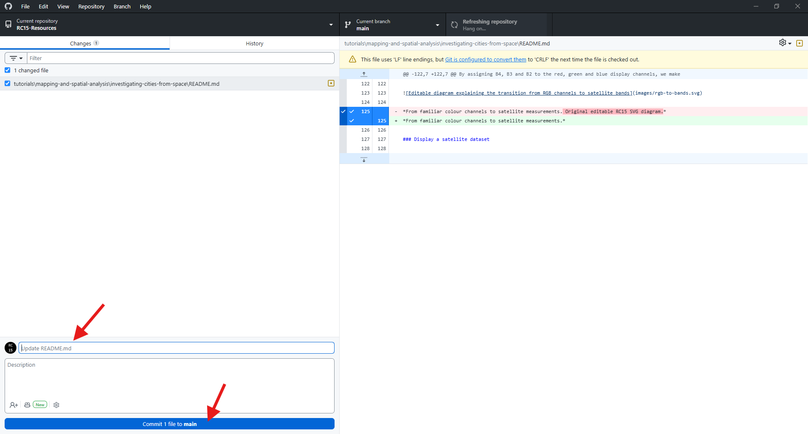
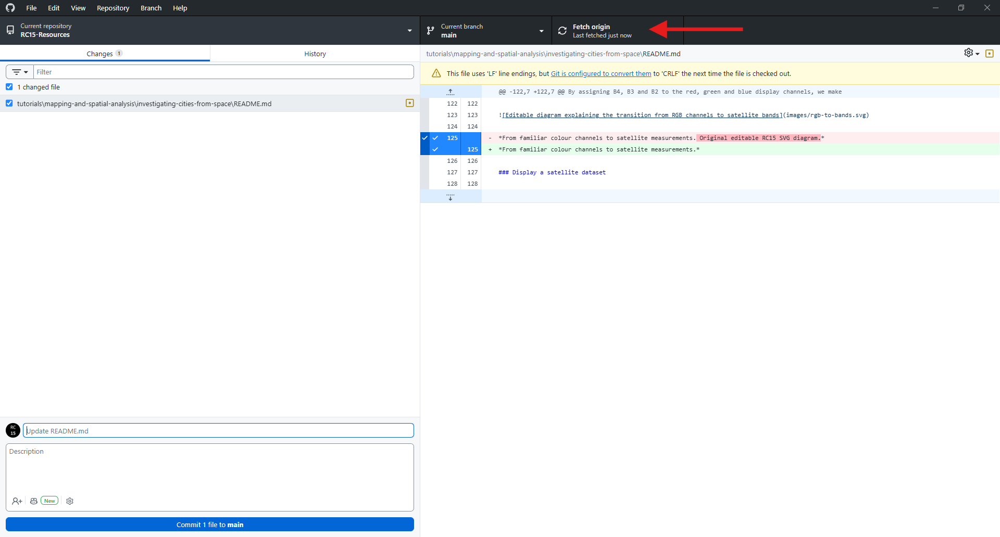
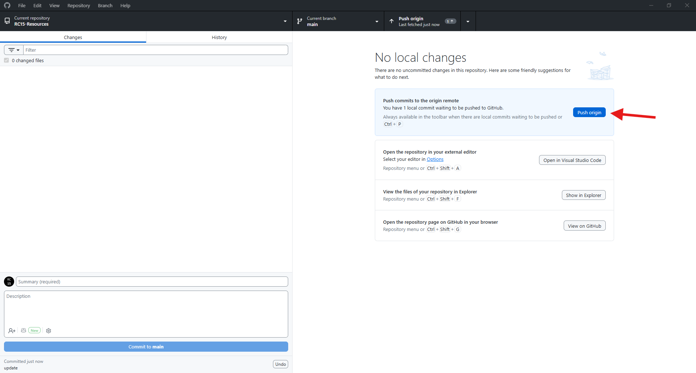
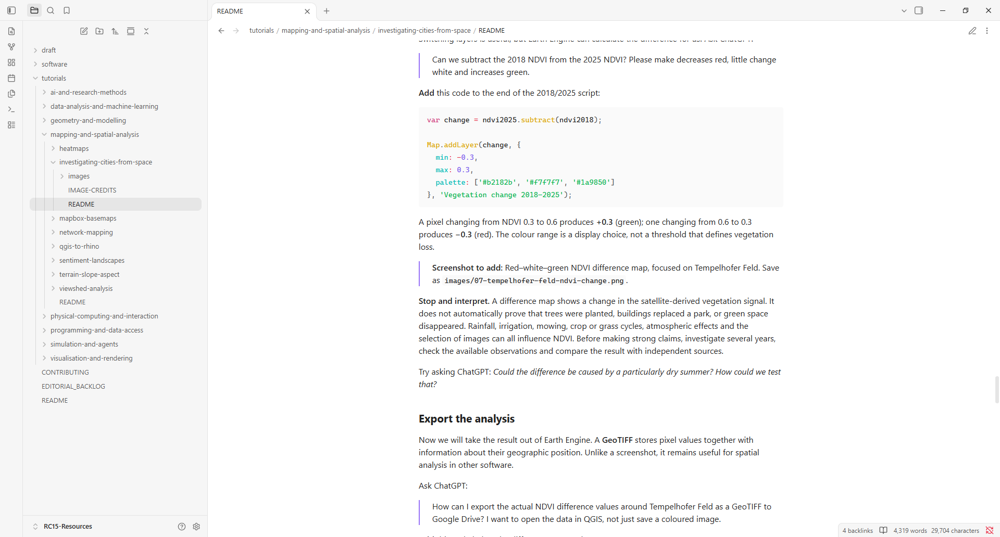
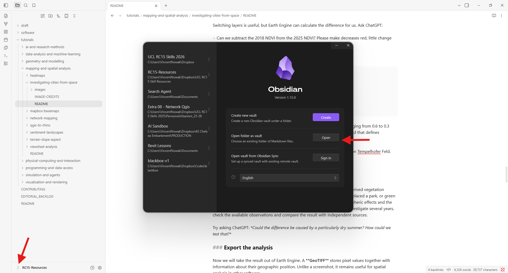
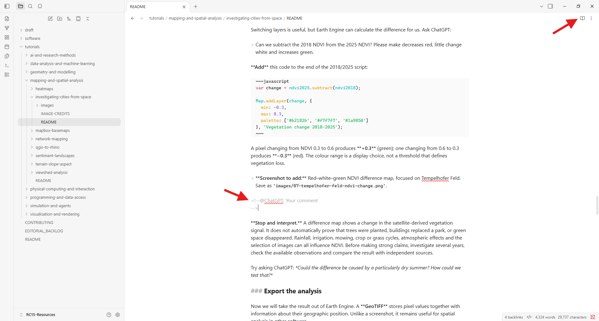

# GitHub Beyond Coding

*Build a library of teaching resources, research, notes and ideas that you can develop across computers, your phone and AI tools.*

[← Programming and data access](../README.md) · [RC15 Resources home](../../../README.md)

**Level:** Beginner, with optional intermediate sections  
**Time:** Approximately 2–3 hours to explore the chapters and two exercises; further exploration is open-ended  
**Software:** A GitHub account and [GitHub Desktop](https://desktop.github.com/) (Windows or macOS); later chapters use [Obsidian](https://obsidian.md/) for Markdown editing and [Working Copy](https://workingcopy.app/) for Git on iPhone/iPad. [iA Writer](https://ia.net/writer) is an optional paid alternative. ChatGPT or Claude can assist with writing.  
**Prerequisites:** Basic experience with files and folders; no programming or command-line knowledge required  
**Teaching context:** RC15 – Pervasive Urbanism, Bartlett School of Architecture, UCL. Permanent resource, not tied to a particular teaching year  
**Author:** RC15 Resources teaching team  
**Verification:** Reviewed November 2026. The resource maintainer has used the desktop workflow in practice; the full cross-device sequence and version-specific app steps have not been independently retested.

## Why use GitHub if you are not a programmer?

GitHub is an online platform for storing, organising and collaboratively developing projects. Although originally designed for software development, it is equally useful for maintaining research, written documents, tutorials and collections of knowledge.

A project on GitHub is called a **repository**. Think of it as a folder containing files and subfolders, but with an important additional feature: the history of changes can be recorded. You can see what has been modified, return to earlier versions and collaborate without constantly exchanging new copies of documents.

Behind GitHub is **Git**, the version-control system that records those changes. Git can work independently on your computer; GitHub provides the online platform for sharing and collaborating on repositories. **GitHub Desktop** offers a graphical interface for Git without requiring command-line instructions.

Git works particularly well with text-based files such as code, research notes and Markdown, because changes can be compared line by line. It is less suitable for large 3D models, videos or extensive collections of high-resolution images. Files over 50 MB trigger a warning on GitHub and ordinary Git repositories block files over 100 MB. Larger design assets may be better kept in shared storage and linked from a repository.

The [RC15 Resources library](https://github.com/PervasiveUrbanism/RC15-Resources) demonstrates how tutorials, images, code and supporting files can become a navigable collection. We will explore it, create a repository of our own, develop writing with AI and continue the same work on an iPhone.

### Learning outcomes

By the end, you should be able to explain what Git and GitHub do; clone and update RC15 Resources with GitHub Desktop; recognise the difference between saving, committing, pushing and pulling; create Markdown notes and include images; establish your own private repository; explore Obsidian and AI-supported editing; and work with the same files on an iPhone.

### The three chapters

1. [GitHub and the RC15 Resources library](#1-github-and-the-rc15-resources-library)
2. [Building your own knowledge library](#2-building-your-own-knowledge-library)
3. [Writing and editing on an iPhone](#3-writing-and-editing-on-an-iphone)

---

## 1. GitHub and the RC15 Resources library

### Explore the RC15 Resources repository

Open the [RC15 Resources repository](https://github.com/PervasiveUrbanism/RC15-Resources). You will find tutorials, code examples, images and supporting files, organised into folders. At the centre is a file called `README.md`, which GitHub automatically displays as a formatted page.

In RC15 Resources, this file acts as an illustrated table of contents. It introduces different subjects and links to individual tutorials. Each tutorial usually has its own `README.md`, together with images and other resources. A collection of ordinary files can therefore become a navigable library without needing to build a website.



*Explore the repository and its README, then open a tutorial folder.*

### What is Markdown?

The `.md` extension stands for **Markdown**, a lightweight formatting language. Like HTML, it uses simple symbols to describe a document's structure, but it is much easier to read and write. For example:

```markdown
# Urban Research

## Observations

This is **important**.

- Trees
- Public spaces
- Pedestrian routes

[Visit RC15](https://github.com/PervasiveUrbanism/RC15-Resources)
```

GitHub renders that source as a document with headings, bold text, a list and a link. The `#` creates a heading, `**` makes text bold, and square brackets followed by a URL make a link. An image can be embedded with ``, where the path points to the image relative to the Markdown file.

Unlike a Word document, a Markdown file remains ordinary text. You can open it in almost any text editor, and it does not depend on one application. The special name `README.md` is useful because GitHub automatically displays the file when someone visits its repository or folder.

This simplicity makes Markdown useful with **large language models (LLMs)** such as ChatGPT or Claude. They can read headings, links and paragraphs, help rewrite sections and suggest changes without manipulating a complex document format. Markdown is not required by LLMs, which can use other formats too. Its particular advantage is that both humans and AI can work directly with the same readable source files.

### Install GitHub Desktop and clone the library

Install [GitHub Desktop](https://desktop.github.com/) and sign in to your GitHub account. On the RC15 Resources GitHub page, select **Code** and copy the HTTPS repository URL:

```text
https://github.com/PervasiveUrbanism/RC15-Resources.git
```

In GitHub Desktop choose **File → Clone repository → URL**, paste the address and choose a local folder. Click **Clone**. The repository is now present on your computer. Use **Repository → Show in Explorer** (Windows) or **Show in Finder** (macOS) to open the files. If GitHub Desktop offers to open the project in an editor, you can choose your preferred editor instead.

You can also download a ZIP from the GitHub website. A ZIP is useful for obtaining example files once, but it does not preserve a working Git connection for pulling updates or recording commits.



*Copy the repository URL using the Code menu.*




*Select the repository URL and its destination on your computer.*



*The cloned repository is available as a local folder on your computer.*

### Save, commit, push and pull are different operations

This distinction is central to using Git confidently.

| Operation | Where does it happen? | What does it do? |
| --- | --- | --- |
| **Save** | In the editor, on your device | Changes the file on disk |
| **Commit** | In your local Git repository | Records selected changes and a message in the local history |
| **Push** | From local repository to GitHub | Uploads commits to the remote repository |
| **Fetch** | From GitHub to your computer | Checks and downloads remote changes without applying them to your working branch |
| **Pull** | From GitHub to your local branch | Fetches and integrates remote changes into the local branch |

For example, saving a Markdown note does not automatically update GitHub. Committing it records your work locally, but another device will not see that commit until you push it. Conversely, if someone has updated the online repository, you must pull those changes to see them in your local folder.

GitHub Desktop normally shows **Fetch origin**, **Pull origin** or **Push origin** depending on the state of the repository. Fetch first if you are unsure whether there have been online changes.



*Review changed files before recording a commit.*



*Fetch checks the remote repository for new commits.*



*Push uploads your local commits to GitHub. Pull becomes available when there are remote updates to integrate.*

### Read-only access, contributions and branches

Cloning a repository does **not** grant permission to publish changes to its original online copy. You can read RC15 Resources and pull updates, but pushing to the shared remote requires write access. A **branch** is an independent line of development; a **fork** is your own GitHub-hosted copy of another repository; and a **pull request** proposes changes for review. You do not need these for the first exercise.

### Exercise 1 — Explore RC15 Resources on your computer

Clone RC15 Resources using GitHub Desktop. Open a tutorial's `README.md` in a text editor and compare its raw Markdown with the formatted version on GitHub. Find a heading, a link and an image reference. Return to GitHub Desktop and select **Fetch origin**; use **Pull origin** if updates are available. There is no need to edit or commit anything.

RC15 Skills repositories contain year-specific teaching material, whereas RC15 Resources is intended to remain useful across academic years.

**Optional video resource:** [Git and GitHub video playlist](https://www.youtube.com/playlist?list=PLRqwX-V7Uu6ZF9C0YMKuns9sLDzK6zoiV) — an additional explanation and demonstration; the written exercise is self-contained.

---


## 2. Building your own knowledge library

So far, we have used GitHub to explore and download an existing repository. But GitHub becomes more interesting when you create your own. A repository need not contain software: it could collect architectural precedents, research notes, design ideas, reading lists or travel observations. Over time these documents can develop into a personal knowledge library.

Unlike a conventional folder of documents, a GitHub repository allows you to record how the work develops, compare earlier versions and collaborate with others. This is particularly useful when writing with AI.

### Create a personal private repository

On GitHub, choose **New repository**. Give it a descriptive name such as `field-notes` or `personal-library`, set its visibility to **Private**, and initialise it with a README. Create the repository, then clone it through GitHub Desktop.

*Private* means that the repository is not normally visible to the public, not that its contents are end-to-end encrypted. Do not store passwords, API keys, confidential client material or information you are not authorised to upload. Keep an independent backup of anything important: version history and backups serve different purposes.

A possible folder structure is:

```text
personal-library/
├── README.md
├── research/
│   └── public-space.md
├── places/
│   └── berlin-notes.md
└── recipes/
    ├── roast-chicken.md
    └── images/
        └── roast-chicken.jpg
```

Do not worry about finding the perfect structure. Start small and rearrange it when you understand how you use the collection. Keep filenames descriptive and use consistent naming. Photos and other binary files can make a repository grow quickly, so avoid importing an entire camera library.

### Write your first Markdown note

Now put the formatting from Chapter 1 into practice. Create a file called `public-space.md` inside your own repository:

```markdown
# Public Space Observations

## Location

A square near the station.

## Questions

- Who uses the square in the morning?
- Which spaces are shaded?
- Where do people stop?

[RC15 Resources](https://github.com/PervasiveUrbanism/RC15-Resources)


```

The example expects an image at `images/square-sketch.jpg`, relative to this Markdown file. You can leave out the image line until you have a suitable sketch.

The [GitHub Markdown guide](https://docs.github.com/en/get-started/writing-on-github/getting-started-with-writing-and-formatting-on-github/basic-writing-and-formatting-syntax) is a useful reference when you need other formatting. Markdown also works in editors beyond GitHub: for example, [Google Docs supports importing and exporting Markdown](https://support.google.com/docs/answer/12014036), although not every feature translates between formats.



*Compare the source of a short Markdown note with its formatted preview.*

### Make your first commit

Edit your note, then return to GitHub Desktop. The **Changes** tab shows the files that changed; for text files, it highlights added and removed lines. Read the difference carefully. Enter a meaningful commit message, for example `Add initial public space observation`, then select **Commit to main**. This records the changes locally.

Now select **Push origin** to send the commit to GitHub. Open the repository in a browser to confirm that the file appears. If you edit the same repository from another device later, pull before making new changes.

A good commit message describes the change rather than saying `update` or `stuff`. Several small, understandable commits are often more useful than one enormous commit after weeks of work.


### Obsidian: a different way to navigate the same notes

[Obsidian](https://obsidian.md/) uses a *vault*, which is simply a local folder of Markdown notes. Open Obsidian, choose **Open folder as vault** and select your cloned personal repository. Obsidian does not replace Git: it provides writing, search, links between notes and optional graph views, while GitHub Desktop manages the version history and synchronisation.

You can link notes with syntax such as `[[Berlin Notes]]`. This is convenient inside Obsidian, but ordinary Markdown links such as `[Berlin notes](../places/berlin-notes.md)` are more portable and work on GitHub. Decide which style suits the intended audience. Obsidian also creates an `.obsidian` settings folder; review whether you want to track those preferences in Git.

You do not need a Git synchronisation plugin to start. Continue committing and pushing through GitHub Desktop. Automatic synchronisation can be added later, once you understand how changes and conflicts are handled.



*How to open a folder as Obsidian Vault*

### Writing with AI: from a short note to a book

ChatGPT, Claude and other large language models can help develop ideas, organise research, draft paragraphs, review arguments and improve clarity. How you work with them should depend on the length and complexity of the document.

For a short email or a few paragraphs, a conversation may be enough. A tutorial like this one benefits from planning. A research paper, dissertation or book requires a more structured approach.

One reason is that **LLMs have a limited context window**: the amount of information they can consider at once. As a conversation grows, earlier decisions may eventually fall outside that window or be summarised. The AI might then overlook a decision, repeat an argument or introduce inconsistencies. Even a long context window does not guarantee equal attention to every detail.

Markdown and GitHub offer a practical response. Instead of relying on a conversation to remember everything, record the structure, editorial decisions and text in files the AI can revisit.

#### Establish editorial guidelines

Before writing a substantial document, agree on its audience, writing style, terminology, technical depth and use of illustrations. An `EDITORIAL_GUIDELINES.md` file can record these decisions, along with principles such as avoiding repetition, distinguishing evidence from interpretation and explaining unfamiliar concepts.

An authorised AI assistant can be asked to read these guidelines before drafting or revising. The file provides continuity, but does not replace editorial judgement.

#### Develop the text in stages

Consider writing an illustrated book about computational methods in architecture. Rather than asking an AI to write the entire book, develop it in five phases:

| Phase | What happens | Example file |
| --- | --- | --- |
| **1. Concept and direction** | Define the purpose, audience, central argument and what belongs in the book. | `01_CONCEPT.md` |
| **2. Content development** | Establish the table of contents and short key points for each chapter; identify gaps and overlaps. | `02_CONTENT.md` |
| **3. Visual development** | Plan diagrams, screenshots and examples in a visual storyboard. | `03_VISUAL_STORYBOARD.md` |
| **4. Detailed chapter planning** | Outline the purpose and supporting examples of each paragraph before drafting. | `04_CHAPTER_PLANS.md` |
| **5. Writing and refinement** | Draft individual chapters in Markdown, verify examples and revise repeatedly. | `chapters/01-introduction.md` |

The process is not entirely linear. Writing may reveal a gap in the concept or suggest a better illustration. You can return to an earlier phase, revise the corresponding file and continue.

#### Revision is part of writing

The first draft is rarely the final one. Review the argument, structure, clarity, examples, technical accuracy, illustrations and writing style. Some passages will need many iterations; others may need to be removed. There is no fixed number of revisions that guarantees a good result.

Git lets you record substantial stages, compare versions and recover earlier material if an AI-assisted rewrite is unsuccessful. **Treat the files in the repository as the authoritative record of the project**, not the AI conversation history. Conversations help develop ideas; documents preserve the decisions and resulting work. AI can propose, question and revise, but you retain editorial responsibility.

#### Conversational and repository-based editing

There are two ways to use AI on these documents. With **conversational editing**, copy a section into ChatGPT or Claude, discuss improvements and paste the result back into your Markdown file. This works without giving the assistant access to your repository.

With **repository-based editing**, an authorised AI environment can read and sometimes modify files through a connector or a local project folder. It can consult guidelines, inspect several chapters and propose coordinated changes. The precise capabilities and permissions vary; ordinary chat does not automatically have access to your local files.

For example:

> Read `EDITORIAL_GUIDELINES.md` and `research/public-space.md`. Improve the structure, preserve my observations, distinguish evidence from interpretation and tell me which files you changed. Do not commit or publish until I have reviewed the result.

After any substantial revision, read the Markdown and inspect the Git diff. Check claims, links and citations; do not rely solely on the AI's summary of what it did.

### Instructions *inside* Markdown files

You can also leave editorial directions within the document itself. HTML comments are particularly useful: they are visible in the raw Markdown file but hidden in GitHub's rendered view.

```markdown
# Notes on Public Space

<!--
EDITORIAL NOTE FOR AI REVIEW:
Keep the original observations.
Group the notes by time of day.
Do not invent sources, measurements or quotations.
Suggest changes first; do not publish automatically.
-->

## Observations

People gather along the sunny edge of the square.
```

These are **notes for a future editing process**, not commands automatically executed by GitHub. They will only influence an AI if the model is given the raw file and asked to follow them. Comments also remain in the repository's source and may be read by collaborators, so do not put secrets in them.

For repeated project-wide guidance, some AI tools support special instruction files such as `AGENTS.md` or `CLAUDE.md`. These are **tool-specific conventions**, not a universal GitHub feature. Use them only after understanding which tool reads which file and whether the instructions actually apply.

Crucially, an AI-generated revision is a proposal. Read the resulting Markdown and the Git diff. Check all claims, links and citations, and avoid automatically accepting extensive rewrites you cannot explain. Commit only changes you are satisfied with.



*This syntax ensures that it's not visible, but it's another way to leave more specific instructions to the LLM*

### Exercise 2 — Start a personal knowledge library

Create a private GitHub repository with a README. Add one Markdown note about a place, reading, design question or recipe, and link to it from the README. Open the repository as an Obsidian vault if you wish. Ask ChatGPT or Claude for a focused editorial suggestion, optionally using an HTML comment in the note. Review the change in GitHub Desktop, make a descriptive commit and push it.

The outcome should be a small, readable collection that is yours to develop, rather than a demonstration of how much text AI can generate.

---

## 3. Writing and editing on an iPhone

You do not need to sit in front of a desktop computer to develop a text or code project. A phone can be a convenient place to discuss an idea with an AI assistant, refine a paragraph or correct a tutorial while travelling. Much of the written material in RC15 Skills and Resources has been developed with AI assistance, partly on desktop and often on the phone. The important thing is to keep working on the same files rather than leaving successive drafts scattered between applications and chat conversations.

Two apps make this possible. **[Obsidian](https://obsidian.md/)** is a free Markdown editor for personal use on iPhone as well as desktop. Its *Live Preview* lets you edit text with much of the formatting visible, avoiding repeated switches between separate source and preview screens. **[Working Copy](https://workingcopy.app/)** is the Git client: it connects your local files to GitHub and handles commits, pulls and pushes. Working Copy is free to download, but pushing and certain other functions require a paid Pro unlock; eligible students may obtain Pro access through the [GitHub Student Developer Pack](https://workingcopy.app/education/).

These apps complement one another. Obsidian handles the writing and navigation; Working Copy manages versions and synchronisation. **[iA Writer](https://ia.net/writer)** is another Markdown editor available as a paid alternative, but it is not required for this tutorial.

A useful routine is to discuss the structure of a tutorial with ChatGPT or Claude on your phone, develop the Markdown in Obsidian, then review and commit the changes in Working Copy. The same repository can be continued later on your computer without reconstructing earlier drafts from chat messages.

### Connect Working Copy and Obsidian

Install both applications and authorise Working Copy to access your GitHub account. In Obsidian, create an **empty local vault** on your iPhone rather than placing it in iCloud Drive. A *vault* is simply the folder in which Obsidian keeps your Markdown files.

In Working Copy, clone your own repository from GitHub, then link the repository with the local Obsidian vault folder. Working Copy's **external directory** linking can connect a Git repository to a folder managed by another application; the precise menu names can vary between versions. Follow the [Working Copy user guide](https://workingcopy.app/manual.html) and [Obsidian's Working Copy guidance](https://obsidian.md/help/sync-notes) for the current setup. Check that an existing Markdown note from the repository appears in Obsidian before proceeding.

It is important to work with **one linked set of files**, not separate copies of the repository in each application. If edits appear in Obsidian but not in Working Copy, check that you linked the correct vault folder. Avoid enabling several independent synchronisation services for the same vault, as that can create conflicting versions.

### Write in Obsidian

Open a Markdown document in the linked vault and enable **Live Preview** if necessary. Edit a paragraph, follow links between notes or add a heading. You can continue working on the phone even when a long document would be inconvenient to handle in a chat window.

Return to Working Copy and inspect its changes. Commit with a descriptive message and **Push** to GitHub. Before starting a new editing session on the phone, **Pull** any changes made on another device. Obsidian does not itself push Git commits: Working Copy is responsible for that part of the workflow.

Small supporting images can live alongside your Markdown where useful, but Git repositories are not intended to become large photograph archives.

### Two useful iPhone tips for AI-assisted writing

**Apple Shortcuts.** The built-in [Shortcuts app](https://support.apple.com/guide/shortcuts/welcome/ios) can combine several actions into a reusable workflow. For example, you can make a shortcut that takes selected text from the Share menu, adds a standard prompt and copies the result to the clipboard for use in ChatGPT. Start with a simple text-handling shortcut before attempting to automate a more complicated writing process. Shortcuts does not replace Git or automatically synchronise your repository.

**Keyboard Text Replacement.** When reviewing Markdown on a phone, repeatedly typing an editorial comment is awkward. iOS can expand a short abbreviation into a longer piece of text. Go to **Settings → General → Keyboard → Text Replacement**, tap **+**, and enter a phrase such as:

```text
<!-- @ChatGPT: Review this paragraph for clarity. -->
```

Give it a short abbreviation, such as `;;ai`. When you type that abbreviation in a compatible text editor, the iPhone can offer to replace it with the complete comment. You can then edit the instruction to suit the passage.

The `@ChatGPT:` label is only a convention for making editorial notes easy to recognise: it does not automatically contact ChatGPT. As with the HTML comments introduced in Chapter 2, an AI needs access to the Markdown source and an explicit request to act on the note. Text replacement behaviour may differ across editors, so try it first in your preferred app.

### Return to your computer

After pushing from the iPhone, open the same repository in GitHub Desktop on your computer and select **Fetch origin**, then **Pull origin**. The updated Markdown file should appear locally. Open it in Obsidian or another editor to confirm the changes are present.

Try the reverse direction too: edit in Obsidian on your desktop, commit and push with GitHub Desktop, then pull the latest changes in Working Copy before reopening the note on your phone.


## Sustainable Git habits

A reliable routine is to **pull before working on another device; edit; review changes; commit with a meaningful message; and push when you want the updated work available elsewhere**. Discuss substantial restructuring in shared repositories before changing files others rely on.

Keep project decisions, Markdown documents and editorial guidelines in the repository, where they can be revisited over time. Git records how the work changes, while the files themselves preserve the argument and its supporting material.

## Further reading and official documentation

- [GitHub Desktop documentation](https://docs.github.com/en/desktop) — installation, cloning, commits and synchronisation
- [Cloning and forking repositories](https://docs.github.com/en/desktop/adding-and-cloning-repositories/cloning-and-forking-repositories-from-github-desktop) — local copies, forks and permissions
- [GitHub's basic Markdown syntax](https://docs.github.com/en/get-started/writing-on-github/getting-started-with-writing-and-formatting-on-github/basic-writing-and-formatting-syntax)
- [Working Copy user guide](https://workingcopy.app/manual.html) — Git on iOS, Files integration and external editors
- [Obsidian: how notes are stored](https://obsidian.md/help/data-storage) — Markdown vaults and local files
- [VS Code custom instructions reference](https://code.visualstudio.com/docs/agents/reference/custom-instructions-reference) — examples of tool-specific AI instruction files