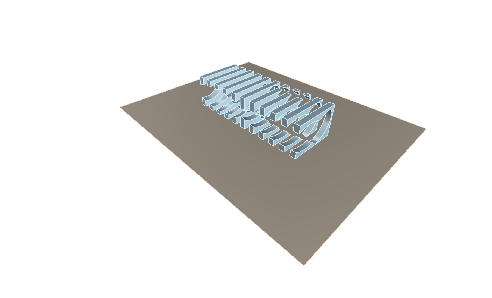
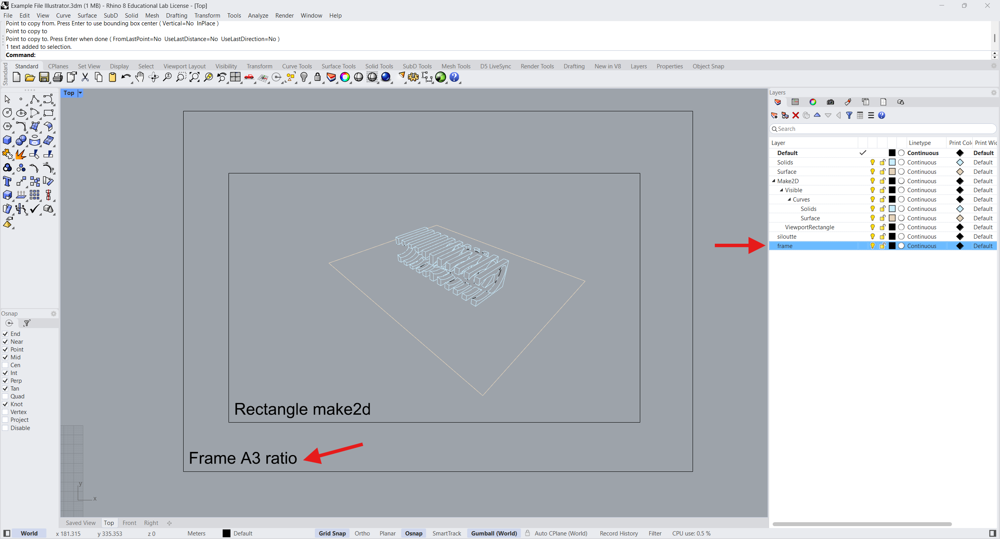
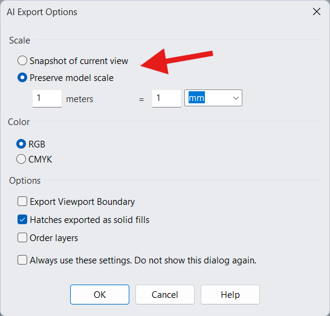
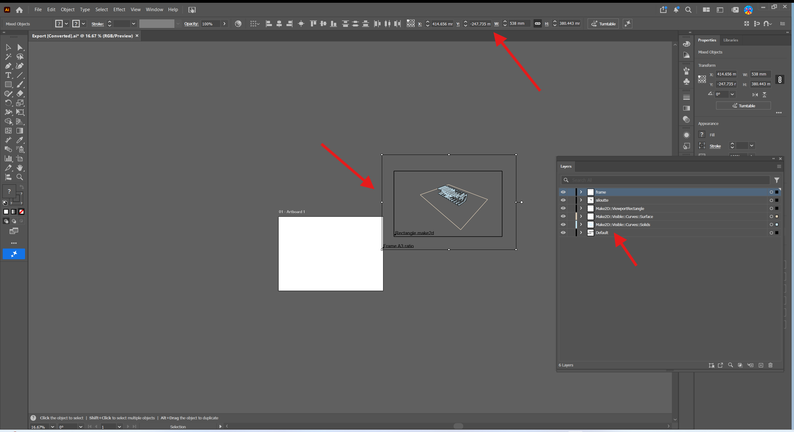
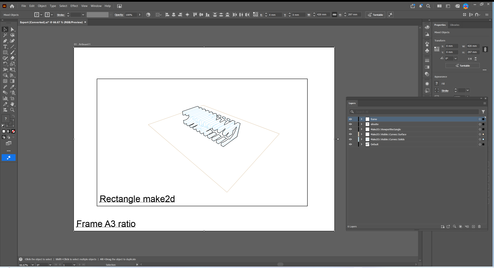
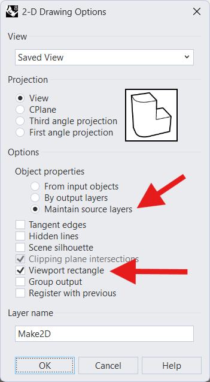
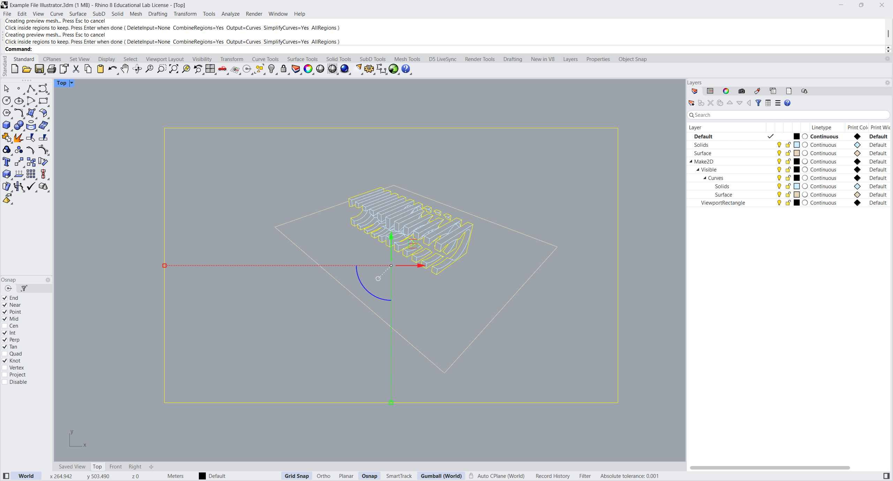

# From Rhino to Illustrator: working with vector drawings

[RC15 Resources](../../../README.md) · [Visualisation and rendering](../README.md)

Rhino and Adobe Illustrator are both excellent tools for working with vector geometry, but they have different strengths. Rhino offers precise control over drawing and manipulating curves, including the ability to generate two-dimensional drawings from 3D models using Make2D. Surprisingly, if you come from a CAD background, even relatively simple operations with lines and curves can feel cumbersome in Illustrator. However, Illustrator offers much greater flexibility when it comes to graphic appearance, colours, line weights and visual composition.

Combining the two allows us to take advantage of both applications. Moving geometry from Rhino to Illustrator is straightforward: select the objects and export them as an Adobe Illustrator (`.ai`) file. The challenge begins when we want to continue working on the drawing.

As a project develops, we may need to add geometry in Rhino, remove unwanted lines, update an existing drawing or bring elements back from Illustrator. If each exchange requires manually repositioning, rotating or scaling the artwork, the process quickly becomes frustrating and introduces inaccuracies.

This tutorial introduces a simple workflow for transferring vector drawings between Rhino and Illustrator while **preserving their position and orientation**. The illustrated example uses a perspective view, where the A3 frame helps maintain a consistent composition and alignment between exports. For plans, sections and elevations that must be drawn to scale, we will also need to control the exact dimensions of the frame and the export scale.

**You need:** Rhino and Adobe Illustrator. Start with [Example File Illustrator.3dm](Example%20File%20Illustrator.3dm); the three supplied Illustrator files are references. You can also use the separate [2D Rhino Template (Concept Design)](https://github.com/PervasiveUrbanism/2D-Rhino-Template-Concept-Design), which includes A3 frames, scale factors, layers and drawing styles.

## 1. Establish an A3 reference frame

Before exporting, create a rectangular **reference frame** in Rhino with the proportions of an A3 sheet (420:297 for landscape orientation). The frame gives successive exports a common boundary, making it easier to position and combine them in Illustrator.

**For the perspective drawing shown in the screenshots, the exact size of the frame in Rhino is not important.** What matters is its proportion, position and consistency between exports. A perspective has no single measurable drawing scale. By contrast, if you are preparing a plan, section or elevation at a specified scale, the frame must have precise dimensions in model space.

### For drawings that need to be to scale

An A3 sheet measures **420 × 297 mm**. When a Rhino model is drawn in **metres**, an A3 plan at 1:1000 covers 420 × 297 metres in model space. At a larger drawing scale, the frame covers a smaller area of the model. The table below applies to **scaled orthographic drawings**, not to the perspective example.

| Intended A3 scale | Frame in Rhino (model units: metres) |
| --- | --- |
| 1:1000 | 420 × 297 m |
| 1:500 | 210 × 148.5 m |
| 1:200 | 84 × 59.4 m |
| 1:100 | 42 × 29.7 m |

You can start with the 420 × 297 m rectangle at 1:1000 and use Rhino's `Scale` command with a factor of **0.5** for 1:500 or **0.2** for 1:200. Equivalently, divide the original dimensions by two or five. The sheet in Illustrator remains A3; only the area of the model represented by that sheet changes.

Create the frame with `Rectangle` and place it on a dedicated layer, such as `REFERENCE FRAME`. For a **perspective**, first generate the 2D linework with `Make2D` from the intended view, then position the frame around that drawing. Keep the resulting curves and frame together in a common 2D plane for export. For a **scaled plan**, use the appropriate frame dimensions from the table and keep the drawing in a consistent orthographic orientation.

The [2D Rhino Template](https://github.com/PervasiveUrbanism/2D-Rhino-Template-Concept-Design) already provides A3 frames and a scale-factor table, alongside a simple layer system. You can use it instead of constructing the setup from scratch.

## 2. Export the drawing at the correct scale

Select **both the geometry and the reference frame** in Rhino, then choose **File → Export Selected** and the **Adobe Illustrator (`.ai`)** format. Include the same complete frame in every export: it provides a reliable reference for aligning different versions of the drawing.

For the **perspective example**, choose an export scale that makes the reference frame fit the A3 artboard. This is a graphic sizing decision, not an architectural drawing scale. Use the **same export settings** for each subsequent version.

For a **scaled orthographic drawing**, set the model-to-Illustrator scale precisely. The important relationship is between the units on each side, not simply the ratio written on the drawing. For example, for a model in metres at **1:1000**, **1 metre in Rhino must become 1 millimetre in Illustrator**. At 1:500, 1 metre in Rhino becomes 2 mm in Illustrator; at 1:200, it becomes 5 mm.

| Intended scale | Illustrator size of 1 m in Rhino |
| --- | --- |
| 1:1000 | 1 mm |
| 1:500 | 2 mm |
| 1:200 | 5 mm |
| 1:100 | 10 mm |

Rhino's export dialogue may express this relationship using its own unit labels and scale fields. Check the labels rather than entering `1:1000` without considering the model units. For a scaled drawing, the definitive test is the frame: when opened in Illustrator, it must measure **420 × 297 mm**. For the perspective example, you can size the artwork to the page, provided all subsequent exports use the same settings.

## 3. Set up the A3 artboard and a precise origin in Illustrator

Open the exported `.ai` file in Illustrator. First check that the **artboard** is A3 landscape (420 × 297 mm). The artboard is the printable page, whereas the frame is an actual vector rectangle exported from Rhino; they are not necessarily the same size or position when the file first opens.

Select the **Artboard Tool** (`Shift + O`), then choose the A3 preset or enter **W = 420 mm** and **H = 297 mm** in the artboard properties. Make sure the orientation is landscape. Press `Esc` to leave the Artboard Tool. You can check the dimensions in **Window → Artboards** or the Properties panel when an artboard is selected.

Next, select the reference frame and check its dimensions in **Window → Transform**. For a **scaled drawing**, it should measure exactly **420 × 297 mm**. If not, return to Rhino and correct the export scale; do not resize the drawing manually in Illustrator. For the **perspective example**, the frame only needs to match the A3 proportions and be fitted consistently to the artboard.

We now need a repeatable position for the geometry. Select **all the exported artwork, including the frame**, and open **Window → Transform**. In the panel's nine-point reference-point selector, choose the **upper-right point**. Set **X = 0 mm** and **Y = 0 mm**. This moves the entire selection together so that the upper-right corner of its bounding box sits at the chosen origin.

For this to work as intended, the frame must define the outer bounds of the selection: keep all exported geometry inside it, and ensure there are no stray objects outside the frame. Also use the **same ruler origin and artboard-coordinate settings** in every Illustrator document. The coordinate origin and the artboard's top-right corner are not necessarily the same thing; setting X and Y to zero is a registration convention, not an instruction to place the drawing at the artboard's top-right corner.

With the frame aligned to the A3 artboard and the geometry positioned at a fixed coordinate, we have a repeatable reference for subsequent exchanges. Exact frame dimensions are essential only when the drawing must remain at a specified scale.

## 4. Add geometry without losing alignment

Return to Rhino and add or change some of the 2D linework. Keep the **original reference frame unchanged**. Select the new or revised geometry **together with the frame**, then use **Export Selected → Adobe Illustrator (`.ai`)** with exactly the same scale settings as before.

Open this second `.ai` file in Illustrator. As in the first export, select all the artwork including the frame, choose the **upper-right reference point** in **Window → Transform**, and set **X = 0 mm** and **Y = 0 mm**. Both exports now share the same registration coordinates.

Before copying, enable **Paste Remembers Layers** in Illustrator's Layers panel menu. This helps preserve the layer structure when transferring objects between documents. Copy the selected artwork, switch to your original Illustrator document, and choose **Edit → Paste in Place** (`Ctrl + Shift + V` on Windows; `Cmd + Shift + V` on macOS). Because both documents use the same coordinate system and the exported drawings have been registered in the same way, the geometry should land in the correct position without manual scaling, rotation or nudging.

Check that the frames coincide. Then hide or delete the duplicate frame and remove or replace any obsolete geometry as needed. Keeping Rhino linework on identifiable layers makes these updates easier to manage without disturbing Illustrator annotations and graphic treatments.

**The essential routine is simple:** export with the same frame and settings; set the upper-right reference point to X = 0, Y = 0; copy; then **Paste in Place** with **Paste Remembers Layers** enabled. Repeat whenever the drawing changes.

## 5. Develop the graphic in Illustrator

Once the geometry is correctly positioned, Illustrator is where you can refine the graphic hierarchy. Make the principal outlines stronger, keep secondary lines lighter, and introduce colour or fills where they improve the drawing's clarity. The drawing remains vector-based, so the paths can be edited without the loss of quality associated with raster screenshots.

Keep the frame and the drawing geometry separate from annotations, colours and other graphic elements. This makes it easier to replace one set of Rhino lines without rebuilding the entire Illustrator composition.

## 6. Try it with the supplied files

Open [Example File Illustrator.3dm](Example%20File%20Illustrator.3dm) in Rhino and prepare a 2D projection of the perspective view within an A3-proportioned reference frame. Export it and fit the composition to the Illustrator artboard. If you instead work with a plan at a specified scale, use the precise frame dimensions and export settings described earlier. Then change the Rhino geometry and repeat the export. Position both exports at X = 0, Y = 0 using the upper-right reference point, and transfer the new linework with Paste in Place and Paste Remembers Layers.

The folder also contains [Example 01.ai](Example%2001.ai), [LINEWORK.AI](LINEWORK.AI) and [LINEWORK2.AI](LINEWORK2.AI). These are reference files from the original exercise. Their precise graphic content and layer structure have not yet been checked visually, so compare them with your own export rather than assuming they represent consecutive stages.

## Pro tips: keeping Make2D drawings consistent

**Include the viewport boundary in Make2D.** When generating a drawing with Rhino's `Make2D` command, enable the option to create a rectangle representing the viewport boundary. The resulting rectangle travels with the projected curves and gives you an additional reference for positioning successive drawings. Unlike the A3 frame, this boundary reflects the view used to generate the projection, so it is important to keep the viewport consistent.

**Use a floating viewport for a repeatable view.** Rhino also lets you work with a floating viewport whose window dimensions can be specified in the **Properties** panel. Setting the viewport dimensions deliberately helps you maintain a consistent aspect ratio and view boundary when generating `Make2D` drawings on different occasions. Keep the view direction and projection settings unchanged as well: matching viewport dimensions alone does not guarantee identical projected geometry.

**Align rendered images and screenshots with the linework.** A floating viewport's dimensions can be set precisely in Rhino's **Properties** panel. This is useful beyond `Make2D`: by keeping the same viewport, camera and projection, you can also capture screenshots or render images with a repeatable framing. For example, export clean vector linework with `Make2D` and place an image with **ambient shadows** beneath it in Illustrator, or combine several renders into a **shadow study** showing different times of day. Use consistent image dimensions and a common registration boundary so the raster image and vector drawing align. Note that setting the viewport's width and height alone does not guarantee an exact match: the view and export/capture settings must also remain consistent.

These are alternatives for controlling the **Make2D projection and its reference boundary**. They complement rather than replace the A3 frame and the Illustrator export-scale settings described above.

## If something does not work

| Problem | First thing to check |
| --- | --- |
| The frame is not 420 × 297 mm in Illustrator | Check the Rhino model units and the model-to-Illustrator export scale. |
| Updated geometry appears in a different position | Include the unchanged frame, set the same upper-right Transform reference point to X = 0 and Y = 0 in both documents, and use Paste in Place. |
| The drawing has rotated | Keep the 2D geometry and frame in the same Top-plane orientation for every export. |
| Some lines are missing | Confirm that the intended Make2D curves are visible and included in Export Selected. |
| The exported drawing contains overlapping lines | Check for duplicate curves or overlapping Make2D results in Rhino. |
| Illustrator graphics do not import cleanly into Rhino | Simplify or expand complex Illustrator appearances and check imported units and frame dimensions. |

---

**Editorial status:** Revised tutorial draft. The A3 frame and scale calculations for orthographic drawings follow the existing RC15 2D Rhino Template. The precise Rhino export dialogue settings, Illustrator coordinate conventions, repeated-import behaviour and Illustrator-to-Rhino round trip still require desktop verification.
